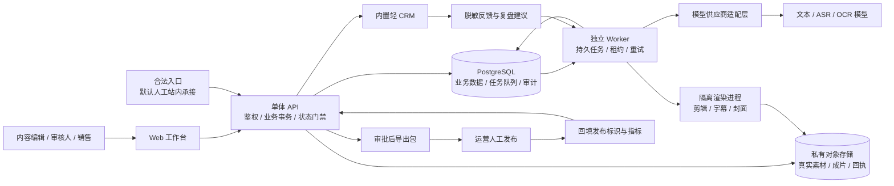

# 楼响 HouSignal｜技术架构与 Agent 工作流

版本：v0.1　日期：2026-10-11　状态：待技术合伙人与试点负责人评审

本文定义首个付费试点的实现边界。以下技术选型、性能数值和部署拓扑是建议方案，尚未实现或部署；平台权限也尚未代表任何试点账号已获准。对象、接口与枚举以 [数据模型与 API 契约](06_数据模型与API契约.md) 为实现依据。

## 1. 系统交付目标

首个 MVP 交付的是一个可审计的业务闭环：一个豪宅销售团队组织（Tenant）服务一个真实楼盘（Property），在一次内容活动（Campaign）中，用已授权的真实素材完成选题、脚本、成片、人工审批、人工发布回执、咨询承接和销售反馈，再形成下一轮内容建议。“一个客户”指购买软件服务的销售团队，不是只允许记录一名购房者。

系统的核心价值是保存专业判断的依据，减少制作和协作成本，并识别哪些内容带来了经销售确认的需求。它不能以播放量或模型评分代替销售资格确认，不能把下载视频计为发布，不能把匿名点击计为客户。

P0 采用固定、有检查点的工作流。这里的 Agent 是执行边界明确的任务模块；没有能够自行寻找素材、开通账号、发布内容、私信用户或修改 CRM 的自治总 Agent。

### 1.1 P0 必须实现

| 能力 | 实现要求 | 完成证明 |
|---|---|---|
| 素材入库 | 用户上传真实视频、图片、录音和资料；记录来源与用途授权 | 文件校验、授权记录、可预览且租户隔离 |
| 楼盘事实库 | ASR/OCR 辅助抽取草稿，人审确认、事实版本与有效期 | 每条对外事实能追到资料页/录音时间段/责任人 |
| 选题与脚本 | 按客群问题、楼盘事实和内容方法生成候选 | 输出事实引用、未解问题与人工修改版 |
| 分镜与成片 | 用真实素材剪辑；字幕、封面、渠道文字适配 | 审核对象是实际播放的最终媒体字节 |
| 发布审批 | 冻结事实、脚本、媒体、授权、CTA 与渠道文案 | 一次批准只允许导出该准确版本 |
| 发布与复盘 | 人工发布，人工填写真实发布标识、平台指标及凭据 | 记录 post_id 或 URL，不依赖平台 API |
| 咨询与轻 CRM | 合法入口、授权信息、人工分配/联系/资格确认/推进 | InquiryCandidate 与 QualifiedLead 分别统计 |
| 下轮建议 | 汇总内容反馈与脱敏销售反馈，输出建议 | 人工批准后才能进入新内容版本 |

### 1.2 P0 排除

无授权平台抓取、批量账号养号、自动发布、自动私信、平台 Cookie 接管；第三方视频批量下载与洗稿；声纹克隆；用生成图或视频改变楼盘结构、窗外景观、面积、装修现状；保证投资回报；自动判定客户“有购买力”；自动向客户外发消息；跨租户共享客资；以消费者联系方式微调模型；完整广告投放系统与大型 CRM 替代。

视觉生成若在后续启用，仅作为清楚标记的示意表达，不能伪装成房屋实拍。本版本优先做字幕、真实图文排版和真实素材剪辑，不把生成式房屋画面列为交付前置条件。

## 2. 建议架构



### 2.1 技术栈建议及替换边界

| 部件 | P0 建议 | 选用原因 / 可替换要求 |
|---|---|---|
| 工作台 | React + TypeScript；现成组件库 | 素材预览、状态反馈、表单与审核差异视图；无需原生 App |
| API | Python + FastAPI | 文本/音视频工具集成便利；可换其他框架，但不能改变状态门禁 |
| 持久层 | PostgreSQL | 关系约束、事务、可追溯版本、租户隔离；无需图数据库 |
| 任务队列 | P0 用 PostgreSQL 持久任务表；独立 worker 消费 | 把业务写入与任务创建放在同一事务；拥塞明显时可迁移 Redis/RabbitMQ 等 |
| 对象存储 | 国内可用私有对象存储；封装统一接口 | 原始文件、代理预览、最终成片、授权证明；存储区域按合规方案确认 |
| 视频处理 | FFmpeg 等标准剪辑工具 + 固定模板 | 参数由程序白名单生成，不执行模型提供的命令 |
| AI | 一家主供应商 + 可替换 adapter | 先用真实试点素材比对质量、区域、数据处理条款和成本，不先绑定“最强模型” |
| 运行部署 | API、worker、定时维护任务分进程；托管数据库与对象存储 | 单代码仓库即可；测试/生产凭证、数据和存储桶分离 |
| 可观测 | 结构化日志、任务/成本/异常指标、告警 | 日志默认无电话、原始客资或完整签名链接 |

长任务需要持久队列和独立进程，不能仅靠 HTTP 进程的内存后台任务保证恢复；FastAPI 官方也把重计算与轻量进程内后台任务区分。此处使用数据库队列，是针对小规模试点的工程选择。[FastAPI Background Tasks 官方说明](https://fastapi.tiangolo.com/tutorial/background-tasks/)

数据库队列可用 `FOR UPDATE SKIP LOCKED` 领取任务；PostgreSQL 官方将其列为多个消费者访问队列表时的适用场景，同时提醒它不适合一般一致性查询。内容审批、线索资格确认等业务读取仍采用正常事务与锁。[PostgreSQL SELECT 官方文档](https://www.postgresql.org/docs/current/sql-select.html)

### 2.2 代码模块边界

```text
apps/web/                     工作台与入口表单（经批准后启用）
apps/api/                     HTTP、登录、权限、业务状态迁移
apps/worker/                  任务执行、租约、调度、成本账本
modules/property/             楼盘、资料、事实库与事实核验
modules/content/              选题、脚本、分镜、不可变内容版本
modules/media/                上传、授权、素材索引、渲染清单
modules/release/              审批快照、失效传播、导出
modules/publication/          人工发布回执、指标快照
modules/crm/                  入口、咨询、联系方式、资格确认、跟进
modules/review/               复盘、建议与人工采纳
adapters/models/              供应商调用与结构化结果
adapters/storage/             私有文件、签名 URL、删除与校验
adapters/platforms/           权限配置、人工导入；P0 可没有 API 实现
shared/contracts/             Schema、错误码、枚举、事件格式
shared/security/              租户上下文、PII 加密、脱敏、审计
```

业务模块调用供应商 adapter，不能直接依赖某一家模型 SDK 的返回结构。任务输入/输出使用版本化 Schema；更换模型不允许绕过人工审批或改变事实状态。

## 3. 工作流与数据流

### 3.1 先立项，再让模型工作

创建 Campaign 时，人工填写目标客群、楼盘范围、主要问题、内容目的、发布账号和计划入口。系统验证租户拥有该楼盘、素材授权覆盖用途、入口已有可用承接路径；缺失项显示为待办。

首次进入产品即可创建试点活动，但资料不齐时只生成资料清单或带占位的内部草稿，不生成“可发布”结论。上传媒体、事实核验、创作和销售可以由不同人员执行，任何自动步骤都不能代签责任人。

### 3.2 一次内容生产的固定检查点

| 步骤 | 输入 | 机器输出 | 人工动作 | 失败后的下一步 |
|---|---|---|---|---|
| 0. 素材与授权 | 原文件、采集人、用途、授权期限 | 格式/校验/时长、预览代理 | 确认真实来源和外发权利 | 缺授权只允许内部隔离预览 |
| 1. 转写/抽取 | 已通过文件检查的媒体与资料 | 带时间段/页码的转写与事实草稿 | 修正数字、人名、术语，核验事实 | 列出听不清与资料矛盾，不能补编 |
| 2. 选题 | 已核验事实、目标客群、内容方法 | 5–10 个候选；最多 3 个优先推荐：问题/证据/判断/CTA | 选一个方向，补充业务判断 | 素材不足则生成补拍/补证清单 |
| 3. 脚本 | 选题、有效事实、授权表达方法 | 文本、Claim 分类、逐句引用 | 校正事实与观点；明确不适合谁 | 未核实 Claim 保留警告，阻止送审 |
| 4. 分镜 | 选定脚本、真实素材索引 | 时间轴、素材段、字幕、缺镜头清单 | 确认镜头确实证明该说法 | 换素材、改说法或补拍 |
| 5. 渲染 | 冻结分镜与字幕模板 | MP4、封面、字幕、渠道文字草稿 | 观看完整成片，核对剪辑造成的歧义 | 生成新版本，不覆盖旧媒体 |
| 6. 审批 | 最终媒体及全部引用 | 风险清单、Release 审批快照 | 事实审核与发布审核各自留痕 | 退回理由定位到句子/镜头/权利 |
| 7. 导出与人工发布 | 有效 Release | 原样文件包、渠道文案、发布清单 | 用平台正规界面发布 | 发布失败仍只是已导出 |
| 8. 回执与指标 | post_id/URL、时间、截图/导出表 | Publication、MetricSnapshot | 运营确认数据口径、时间窗 | 缺回执不进入已发布统计 |
| 9. 咨询与销售 | 用户主动咨询、合法授权信息 | 咨询候选、分配建议、跟进提醒 | 联系、资格确认、阶段推进 | 保留 pending/unknown，不能模型代判 |
| 10. 复盘 | 同期指标、咨询/销售汇总、成本 | 证据和置信边界明确的建议 | 批准/拒绝建议，创建下一版 | 样本少只做描述，不给因果结论 |

“缺镜头”不能由生成模型伪造房屋实拍补齐。音乐、字体、图片、人物形象及声音的权利范围也必须进入素材授权检查。

### 3.3 Agent 任务契约

| 任务模块 | 允许读取 | 允许写入 | 明确禁止 |
|---|---|---|---|
| FactDraftAgent | 授权资料、转写、页码/时间段 | `unverified` 事实草稿与冲突提示 | 设置 verified；凭常识填面积/价格/学区 |
| TopicAgent | 有效事实、目标客群、已授权内容方法 | 候选选题、需要补证的假设 | 获取竞品私有数据、编造成交案例 |
| ScriptAgent | 人工选题、有效事实、口吻配置 | 新 ContentVersion、Claim 与引用 | 修改楼盘事实；克隆创作者身份/声音 |
| StoryboardAgent | 脚本、带描述的真实素材段 | 分镜清单、缺镜头清单 | 从描述推断未拍到的景观/结构 |
| ChannelAdapter | 主内容、账号已确认规则配置 | 新渠道文案草稿、封面文字 | 自动发布/绕过平台入口规则 |
| ReviewAssistant | 精确版本及事实/授权快照 | 风险与差异清单 | 代替审核人批准、授权无效素材 |
| RetrospectiveAgent | 指标快照、脱敏销售汇总、成本 | Review 建议与限制 | 把相关性称为因果、改CRM阶段、外发客户消息 |

每个任务都必须声明 `input_schema_version`、`output_schema_version`、`prompt_version`、模型标识、参数、输入引用、预算上限与允许工具。工具白名单默认只有租户内只读检索与任务结果存储；它没有文件系统任意读取、Shell、平台账号、私信和任意 URL 抓取权限。

### 3.4 模型输入与输出示例

```json
{
  "task_type": "script_draft",
  "schema_version": "1.0",
  "tenant_id": "t_demo",
  "property_id": "p_demo",
  "campaign_id": "cp_demo",
  "audience_question": "这套房的空间布局适合什么家庭？",
  "verified_fact_refs": [{"fact_id": "f_demo", "revision": 2}],
  "asset_segment_refs": [{"asset_id": "a_demo", "start_ms": 12500, "end_ms": 21000}],
  "style_profile_revision": 1,
  "constraints": {
    "no_unverified_factual_claim": true,
    "no_return_guarantee": true,
    "no_identity_or_voice_imitation": true,
    "target_seconds": 60
  }
}
```

以上 ID 为阅读缩写，正式接口使用 UUID。模型返回结构需包含 `claims[]`、`script_blocks[]`、`missing_evidence[]`、`warnings[]`。Schema 通过只代表结果可解析，仍需确定性事实引用检查和人工审核。

每个 factual Claim 至少绑定一个有效 verified Fact；subjective Claim 标明“主观判断”及判断依据；illustrative Claim 必须明确示意表达，不能支持房屋现状断言。模型对房源引用了错误楼盘、改写数字含义或把样板间说成实际交付房，都视为不合格输出。

## 4. 状态、版本与审批门禁

### 4.1 事实与内容版本

Fact 以 `fact_id + revision` 标识不可变事实快照。每次价值、单位、口径、来源或有效期修改都产生新 revision；状态事件留历史。四个业务状态是 `unverified / verified / disputed / expired`。过期是由服务端时间与 `valid_until` 共同判断，不依赖定时任务是否按时运行。

Content 是业务内容容器，ContentVersion 是不可变的正文、脚本、分镜、字幕与渠道适配版本。编辑采用新建版本而不是覆盖。事实修正不偷偷更新旧脚本；系统提示受影响的内容、审批和发布记录，要求新版本处理。

Asset 的原始字节及 `sha256` 不变；新剪辑、新字幕、新封面和重新转码都是新的输出 Asset。授权状态或适用范围变更产生新的 `rights_revision`，不能通过“文件没有变”继续外发失权素材。

### 4.2 Release 冻结什么

Release 是一次面向指定账号/渠道的外发审批，冻结下列快照，并对规范化 JSON 计算 `snapshot_sha256`：

1. Tenant、Property、Campaign、ContentVersion及楼盘营销许可版本/主体/范围；素材版权不替代房源营销许可。
2. 每个 Claim 对应的 Fact revision、状态、有效期及证据。
3. 所有源素材的 Asset ID、字节校验与 rights_revision；最终视频/封面/字幕输出的 Asset ID 与校验。
4. 渠道、账号引用、标题、正文、标签、字幕、CTA 与必要声明。
5. LeadEntry ID、revision、承接路径、权限检查凭据。
6. 待审规则版本和要求的审核动作；不包含尚未发生的审核决策。

审批快照不可变，状态通过事件推进：`pending_review → approved / rejected`；approved 可转 `invalidated / expired / revoked`。事实审核与发布审核是两个明确动作；试点同一责任人可兼任，但不能由一次无记录按钮自动合并。审核者、时间、意见和决定写独立追加的 ReleaseDecision，并引用同一 reviewed_snapshot_sha256，不回写待审快照；审计导出包可组合原快照与全部决策，但使用独立审计包hash。

只要绑定的事实/脚本/媒体/授权/文案/CTA/入口配置发生实质变化，或动态事实、权利、平台权限已失效，该活动审批即不可继续导出/用于新发布。原审批保留作为历史证据；重新批准产生新 Release。无关楼盘或未被引用的素材修改，不影响该 Release。

每次批准、导出都执行即时门禁：楼盘营销许可、有效事实、素材用途授权、入口能力、账号范围、当前内容版本和审核权限。许可或任何绑定授权到期/撤回都使新外发资格失效。录入发布回执同时检查发布时间的历史有效性和当前风险，但不能因现在到期就拒绝归档过去真实发布；发布时间早于失效且有凭据可按历史核对，失效之后发生的误发仍必须归档并标inconsistent、进入纠正待办。先导出后过期的文件仍可能保存在运营人员电脑中，系统无法阻止其在平台外误发，因此导出附有效期与发布前检查清单；不能掩盖历史。

### 4.3 发布回执独立于导出

Export 记录生成了什么文件以及何人下载。Publication 必须包含 `platform_post_id` 或真实 `post_url`、账号、渠道、人工回填的发布时间及对应 Release。人工回执不冒充官方 API 核验。

Publication 的 `status` 为 `recorded / verified / inconsistent / removed`；`receipt_level` 为 `operator_attested / official_export / platform_api`。P0 默认 operator_attested。verified只在审核了可对应的凭据后人工设置；另用 `platform_state=review_pending/live/rejected/restricted/removed/unknown` 记录平台审核/可见状态，不把审核中或拒绝的作品算作已公开发布。removed保留原发布记录和删除凭据，不能从历史漏斗消失。

若运营在平台编辑器改了字幕、配音、关键数字、标题/CTA等已审批要素，标为 inconsistent，不继续计为“审批一致的有效发布”。该事实可进入“有回执但内容不一致”的异常台账；不能事后批准一个没有核对过的版本来美化验收。

### 4.4 CRM 和反馈不得形成自动外发循环

匿名 SourceTouch、InquiryCandidate 和 QualifiedLead 是不同单位。销售人工资格确认后才建立 lead_id。业务阶段为 `qualified / appointment / visit_completed / opportunity / won / lost / withdrawn`；跟进动作记录在 FollowUp，而不是增加一组同义阶段。

RetrospectiveAgent 只能输出建议；批准建议后创建新的选题/内容草稿，重新走事实和发布审批。CRM 电话、姓名、精确预算、家庭敏感细节不进入创作提示词；若某个客群问题值得用于内容，先转写为去标识的问题并经过销售负责人确认。

## 5. 平台能力与权限矩阵

以下矩阵是产品的权限启用策略，不能作为账号已获能力的证明。每次试点需按账号、主体资质、类目、地区和当期规则做一次可用性核验。

| 场景 | 抖音 P0 | 小红书 P0 | 条件能力 / 替代动作 |
|---|---|---|---|
| 文案/视频/封面适配 | 输出草稿与真实素材文件 | 输出图文/视频草稿与文件 | 规格由运营确认并版本化配置 |
| 发布 | 正规界面人工发布 | 正规界面人工发布 | 后续官方 API 需独立授权和验收；无权限则保持人工 |
| 数据复盘 | 人工录入可见后台指标/正规导出 | 人工录入可见后台指标/正规导出 | 不模拟登录爬后台，不假定指标开放接口 |
| 站内咨询 | 人工查看站内主动咨询 | 人工查看站内主动咨询 | 不把新增私信 API 准入作为依赖 |
| 官方获客组件 | 核验主体权限后配置入口 | 核验账号与组件资格后配置 | `approved_native_component`，保存权限凭据和期限 |
| 站外表单 | 仅当具体路径获许可、信息告知完整时启用 | 同样逐路径核验 | `owned_form_allowed`；不允许则取消外链/二维码CTA |
| 人工合规录入 | 主动咨询后，销售录入客户主动授权的信息 | 同样执行 | 默认 `manual_native`；授权不足只记录脱敏咨询摘要 |
| 自动私信/抓取/跨站用户匹配 | 无 | 无 | 不设计为降级方案 |

LeadEntry 的正式字段只有 `capability_mode`：`manual_native / approved_native_component / owned_form_allowed`。人工站内承接本身也能跑完整试点：内容发布→用户主动站内咨询→销售取得必要信息与授权→人工录入→资格确认→跟进。它可能缺少精确点击量和跨渠道识别，指标必须保留 unknown，不能补造归因。

对于能力未开通的组件，系统不显示已开通、不生成可用二维码、不接受假回调；只展示待核验任务。平台 adapter 应提供 `capability_snapshot`，而非把“接入了某 SDK”当作取得权限。

## 6. 任务可靠性与模型成本

### 6.1 持久队列与租约

HTTP 创建任务时，在一笔事务内写 Run、预算预留、输入快照和队列记录；响应 202 与 run_id。worker 领取可执行任务后写 `lease_owner / lease_until / attempt / fencing_token`，短事务提交后执行外部调用，不能在模型调用期间占数据库行锁。

建议起始配置：租约 60 秒、每 20 秒心跳，文本请求超时 90 秒；长音视频任务按时长单独估算上限并持续心跳。以上是调试起点，不是用户服务承诺，需用真实素材校准。

worker 写回结果时比较 fencing_token，只允许当前租约写入；旧 worker 即使晚返回，也不能覆盖新尝试。超时结果标为 unknown_outcome，先查询供应商任务状态或校验对象存储，再决定是否重试；不能默认“超时就没有计费”。

### 6.2 状态与重试

Run：`queued / running / waiting_human / succeeded / failed / cancelled / unknown_outcome`。可重试的是网络暂时失败、供应商限流和 worker 租约丢失；不可自动重试的是缺权利、事实争议、非法输入、预算超限、人工拒绝与确定的内容安全拒绝。

| 故障 | 系统动作 | 用户看见什么 |
|---|---|---|
| 429/短暂网络错误 | 带抖动退避，初始最多 3 次；共享限流 | 排队/重试中，可取消 |
| 模型结果 Schema 错 | 原结果隔离；最多一次结构修复且计费 | 生成失败，可改输入后重试 |
| 事实引用非法 | 无权进入可审核态，生成差异提示 | 哪一句缺证据、如何补证 |
| 渲染失败/磁盘不足 | 退出隔离进程，清理临时输出 | 失败步骤及已保存的脚本/分镜 |
| worker 中断 | 租约超时后重新领取，拒绝旧写回 | 任务恢复中，不重复建内容 |
| 供应商任务状态不明 | 保留 unknown_outcome，核对后重试 | 费用待核对，不谎称未发生 |
| 上传中断 | 断点续传或重新上传；完成校验后才能入库 | 素材未就绪，尚不可被工作流引用 |
| 审批后事实过期 | 阻止新导出、提示已发布内容处理 | 哪条事实到期、哪些内容受影响 |

取消是“阻止后续动作和结果采纳”，供应商已经接受的请求不一定能停止或退款。对用户显示已发生/预估费用与后续待核对金额。

### 6.3 幂等与至少一次执行

队列按至少一次执行设计，不声称整个外部调用链 exactly once。业务写入采用唯一键和 CAS；供应商若支持幂等才传递对应请求键，若不支持则在 ambiguous timeout 时停止自动重复计费。

同一任务的 step_key = run_id + step_name + input_snapshot_hash；写回内容版本/输出素材有唯一约束，重复完成返回原结果。所有写 API 使用 Idempotency-Key；相同键不同请求体返回冲突，不创建第二份咨询、发布或资格确认。

### 6.4 成本预算与供应商隔离

每个 Tenant 设置月度软预算、硬预算、最大并发和单次任务预算。先预留估算额度，成功后按供应商实际 token/时长/用量结算；有未知账单时保留预留并告警。硬预算不允许通过切换供应商绕过。

记录文本 token、ASR 分钟、渲染计算分钟、存储字节、出口流量和人工修改时间；没有供应商真实账单时字段标 estimated。成本仪表盘分别显示已确认成本与预估成本，不能用未核对数字宣称 ROI。

模型 adapter 统一 `generate_structured / transcribe / extract_document / check_job / cancel_if_supported`，每个能力单独声明是否可用。原始供应商返回存为受限诊断数据；对外接口只暴露标准结果、可解释失败和 request_id。

## 7. 安全与隐私实现边界

### 7.1 租户与对象权限

每个业务表携带 tenant_id；API 从已验证登录态和成员关系确定租户，不能相信请求体中的租户 ID。所有对象读写检查同租户、项目范围和角色；UUID 不能替代对象授权。OWASP 明确指出接收对象 ID 的 API 都需做对象级权限检查。[OWASP API1 官方说明](https://api-security.owasp.org/editions/2023/en/0xa1-broken-object-level-authorization/)

建议数据库再启用 RLS。运行账号不使用超级用户、表 owner 或 BYPASSRLS；表 owner 通常能绕过 RLS，必要时 FORCE ROW LEVEL SECURITY；migration 使用独立高权限账号。连接池每笔事务用服务端 `SET LOCAL` 绑定租户上下文，结束后必须清除，禁止串租户。[PostgreSQL Row Security 官方文档](https://www.postgresql.org/docs/current/ddl-rowsecurity.html)

### 7.2 客资与模型数据

电话等可联系信息应用层加密后写库，使用受控密钥管理；密文、nonce、key_version 分字段保存。显示默认脱敏，只有被分配销售和获授权负责人能显式查看；查看和导出都有审计。

联系方式匹配使用租户内 HMAC：规范化联系方式 + tenant 专属匹配密钥；它是非唯一候选匹配索引，不是“同一人”的证明。共享家庭电话或公共账号可以对应不同 Contact，系统只向有权限的销售提示候选，由人工确认同人后合并，保留原咨询与授权历史。不能使用无密钥手机号哈希，也不能建立全平台共享身份索引。HMAC 仍视为受保护的个人信息处理字段，密钥不和数据库一起存。密钥轮换须保留迁移映射/双索引窗口，不能把索引轮换误算为新客户。重复提交或同一 webhook 事件则通过幂等键处理，不依赖身份推断。

匿名 source_touch_id 不挂完整 IP、精确设备指纹或跨站追踪标识；IP 可在安全防滥用系统短暂处理，不进入商业归因表。没有同意或可合法使用的来源时，只记录脱敏咨询摘要，不存可联络号码，也不能开展主动联系。

模型只接收完成当前内容任务需要的资料。导入的资料、转写和客户留言视为不可信输入，不能变成系统指令；拦截“把客户号码发到外部”“忽略审核”这类提示注入。默认不将客资传给模型，不用试点素材或客户信息训练公共模型；实际供应商条款、处理区域与数据保留必须在采购前核验。

### 7.3 文件与渲染

上传使用短有效期、限定对象键/大小/类型的签名请求；完成后校验真实 MIME、文件头、sha256、体积和媒体时长。文件先 quarantine，病毒/异常格式检测通过后 ready。原始文件名只作显示值，不能用于拼路径或命令参数。

渲染进程使用无网络、低权限容器/沙箱、只读素材输入目录、独立临时目录和 CPU/内存/时间上限。模型返回时间轴 JSON，程序生成白名单工具参数；不直接执行模型文本、任意插件、下载命令或外部 URL。素材预览、下载和审批截图访问使用短期权限，不公开原始存储桶。

### 7.4 入口与回调

owned_form_allowed 入口要有必要信息告知、独立授权动作、来源口径、撤回入口、防机器人/频控和明确提交反馈；不能预勾选同意或为获取联系方式强制接受无关营销。官方组件能提供什么授权证明，需要逐项核验，不把“平台里点过按钮”自行解释为所有后续用途许可。

如后续接入正式 webhook，用验签、时间窗、事件唯一 ID 和重放表；验证失败不创建咨询。P0 人工导入同样要来源、主动授权凭据和录入责任人；不可通过表格导入绕过这些字段。

### 7.5 保留、删除与历史证据

具体保留周期依合规文档与客户合同配置，不在代码写死。上线前必须填素材、客资、授权、审计、原始模型诊断数据的保留期限；未配置不得开放公网客资采集。

客户撤回联系授权后立即停止主动联系、隐藏/冻结联系人字段并创建删除任务；删除个人信息、密钥引用、模型缓存、索引和存储副本，保留不含可识别信息的处理回执。不可变业务历史不等于永远保留个人信息：必要时对 PII 做删除/不可恢复去标识，历史内容或审计中的非 PII 编号保持可追溯。备份恢复必须重放删除台账，避免把已删除客资重新上线。

## 8. 数据观测与反馈口径

每个请求 request_id、每个任务 run_id、每个版本 content_version_id、每次审批 release_id、每次发布 publication_id 全链路关联；运维日志不能携带原始电话和完整客户留言。

| 观测面 | 必须记录 | 不能声称 |
|---|---|---|
| 系统 | 任务排队/成功率/失败率、耗时、重试、租约恢复 | 一次 Demo 成功代表稳定运行 |
| 内容 | AI 初稿、人审改动、退回原因、事实覆盖、缺镜头 | 模型评分代表内容真实性 |
| 发布 | 有回执数量、版本一致性、下架/撤回 | 导出数量代表平台发布数量 |
| 平台表现 | 指标名、账号、采集时间、时间窗、来源/凭据 | 缺失值当 0、跨平台指标天然可比 |
| 获客 | 触点、咨询候选、资格确认、预约、带看、机会、成交 | 点击=咨询=客户=成交 |
| 归因 | source_confidence=confirmed/self_reported/inferred/unknown；source_granularity=publication/campaign/channel/unknown；evidence_type记录凭据来源 | 人工印象当作确定跨渠道归因；inferred进入确认作品归因 |
| 经济性 | 已确认与预估成本、人工时间、付费续用反馈 | 小样本确定证明增量收入 |

复盘必须标数据覆盖：发布回执完整率、指标填报率、授权信息完整率、来源 unknown 占比、销售资格确认完成率。数据不完整时先给补录任务；不能输出看似精确的“获客率”掩盖未知分母。

## 9. 部署、恢复与验收

### 9.1 环境与发布

至少分本地开发、测试、生产三个环境；测试用合成/脱敏数据。上线 migration 先在测试恢复副本演练；API 与 worker 使用兼容 Schema，输入输出保留版本字段。回滚不删除已写业务数据，不让旧 worker 读取无法解析的新任务。

P0 不必使用 Kubernetes、复杂微服务、长期自主 Agent 记忆、全量向量数据库或实时大屏。素材检索先用结构化标签、人工描述和文字转写；只在真实检索瓶颈出现后引入可租户隔离的语义检索。

### 9.2 备份和恢复目标

建议试点目标：数据库每日备份并启用支持的时间点恢复机制，最终媒体与授权凭据有独立存储版本/恢复策略；试点恢复目标可暂设 RPO ≤24h、RTO ≤8h，签约前以一次实际恢复演练验证。若使用更强目标需测算托管能力与预算，不能把方案写成已经达标。

恢复演练不仅恢复表，还验证：私有媒体能访问、租户隔离不失效、事实/发布引用没有悬空、过期审批不能导出、被删客资不复活、队列只恢复必要步骤、unknown_outcome 不重复收费。

### 9.3 必测场景

| 场景 | 验收结果 |
|---|---|
| 修改 fact 值/有效期后旧审批下载 | 阻止旧 Release；明确受影响句子和新审核任务 |
| 模型引用其他楼盘或 unverified fact | 输出不可送审；不会静默丢弃引用后发出正文 |
| 素材外发授权到期 | 拦截导出；已发布记录进入处理待办 |
| 成片导出但没填发布标识 | 不计为已发布，不产生曝光/咨询转化结论 |
| 重复提交、同电话新咨询/共享家庭电话 | 同提交幂等不重复；同电话只给匹配候选，由销售确认同人或不同人后处理，历史保留 |
| 不同租户相同电话 | 不产生共享身份、候选联系人或推断提示 |
| 模型高分但销售未资格确认 | 保持 InquiryCandidate，不计 QualifiedLead |
| 签名 webhook 伪造/重放 | 不写重复咨询/授权，不泄露验签细节 |
| worker 中断后恢复 | 不覆盖新结果、不重复建版本、不盲重试已计费请求 |
| 客户撤回授权 | 停止联系并发出删除任务，统计保持去标识历史 |
| 归因数据缺失 | unknown，复盘显示覆盖不足，不猜平台来源 |
| 平台账号无官方组件权限 | 默认人工站内承接仍可完成闭环；不显示假组件 |

上述场景对应真实业务约束，应进入后续实现的集成测试与试点验收；本文档本身不代表测试已执行。技术验收可以用显著标为 `is_test=true` 的测试咨询验证授权、资格确认与阶段迁移，这些记录及其联系人/跟进/线索全部排除商业统计，不得外发真实客户消息。真实内容、审核和发布回执与这段模拟 CRM 证据分别标记；测试成功不能证明真实获客。

## 10. 技术合伙人的首轮决定

先确定模型采购与数据处理区域、素材真实授权方式、平台账号可用入口、试点负责人和上线环境。随后实现“真实素材→事实核验→一版脚本→一条真实成片→一次人工审批→一次人工发布回执→咨询录入→资格确认→复盘”的竖向切片。技术验收的咨询段可使用明确测试数据；四周业务验证单独观察真实主动咨询与销售反馈，若真实咨询为0就报告0，不能以造一条客户或等待真实客户出现作为技术完成条件。

在内容生产与人工发布得到真实回执、CRM技术控制通过验证之前，不扩展自动运营、全平台接口、生成式房屋影像或完整 CRM。是否继续扩大商业试点，还要看真实咨询、销售反馈和付费续用意愿，不能仅凭技术演示决定。后续扩展须继承本版本的租户隔离、不可变引用、人审、平台权限和归因未知值契约。
