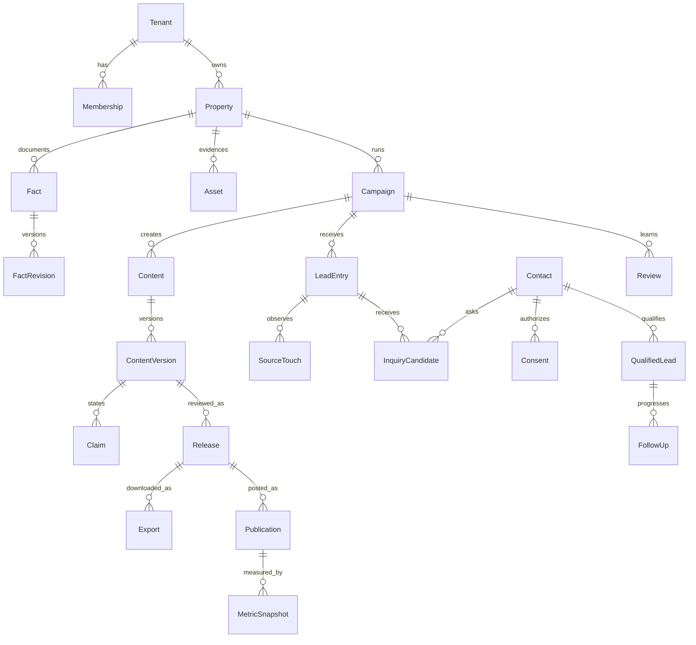

# 楼响 HouSignal｜数据模型与 API 契约

版本：v0.1　日期：2026-10-11　状态：设计契约，尚未实现

目标：让技术合伙人可以实现首个真实试点，同时让产品、内容审核和销售使用同一套对象与计数口径。本文接口属于楼响自身的建议接口，不是抖音、小红书或任何模型供应商已经开放的 API。外部能力以账号实际许可为前提。

## 1. 全局约定

### 1.1 主键与数据单位

所有正式 ID 采用服务端生成的随机 UUID。文档中的 `t_demo / f_demo` 等仅为示意别名，不是正式请求值。业务主键统一如下，不新增同义字段：

| ID | 含义 | 计数边界 |
|---|---|---|
| tenant_id | 购买产品的团队组织 | 与购房者不是同一对象 |
| property_id | 真实楼盘/房源范围 | P0 每个 Campaign 绑定一个 Property |
| campaign_id | 内容获客活动 | 围绕一个客群问题、楼盘与试点周期 |
| content_id | 一条内容的业务容器 | 可包含多版脚本与渠道适配 |
| content_version_id | 不可变内容版本 | 改字、字幕、分镜、CTA 都新建版本 |
| fact_id | 一项可核验事实的稳定标识 | 正确引用还需 revision |
| asset_id | 一份原始或派生文件 | 新媒体字节产生新 asset_id |
| release_id | 一次审批快照 | 不等于文件导出，也不等于发布 |
| publication_id | 一次真实平台发布回执 | 至少有平台 post_id 或 URL |
| entry_id | 一个合法咨询承接入口 | 精确能力由 capability_mode 表示 |
| source_touch_id | 一次匿名/脱敏来源触点 | 不等于咨询、不等于可联系客户 |
| inquiry_id | 一次咨询候选记录 | 多次咨询可对应同一 Contact |
| lead_id | 销售人工资格确认后的主商机线索 | 同租户同Contact同Property仅一个主Lead；不由模型评分创建 |
| contact_id | 租户内一名可联系对象 | 同租户去重，不跨租户共享 |
| consent_id | 一次用途明确的授权记录 | 撤回记录独立追加 |
| run_id | 一次机器工作流执行 | 重试作为 attempt，不当新业务结果计数 |

辅助对象使用 `membership_id / export_id / metric_snapshot_id / followup_id / review_id / event_id` 等语义 ID。辅助 ID 不能替代以上正式业务 ID。

### 1.2 通用类型

| 类型 | 约定 |
|---|---|
| 时间 | RFC3339 UTC，服务端存 timestamptz；工作台按 Asia/Shanghai 展示 |
| 金额/面积 | Decimal 字符串 + 单位 + 口径；禁止二进制浮点与无单位数字 |
| 媒体时间 | 非负整数毫秒，`0 ≤ start_ms < end_ms ≤ duration_ms` |
| revision | 从 1 递增的正整数，服务端生成；不是客户端自由指定 |
| sha256 | 小写 64 位十六进制；服务端验算，不能只信客户端 |
| 未知值 | null + unknown_reason；缺失不是 0，不填虚构默认值 |
| 枚举 | 使用本文正式英文值；中文界面标签可不同 |
| 多租户 | 所有业务表带 tenant_id；引用必须同租户 |
| 版本 | 不可变 payload + 状态事件；不得修改已审批快照的正文 |
| 测试数据 | is_test=true，服务端继承到咨询/联系人/授权/Lead/跟进/任务结果 | 明显标识、不能联络真实客户、全部排除业务统计；fixtures不进入生产房源库 |
| PII | 电话等联系方式密文存储；读 API 默认脱敏 |
| 软删除 | 归档仅用于业务停用；个人信息删除须实际去标识/删除并有回执 |

所有通用业务表包含 `created_at / created_by / row_version`；可变容器再含 `updated_at`。不可变版本不使用 PATCH 修改 payload。行状态更新必须生成对应审计事件。

### 1.3 统一响应与并发控制

成功响应：`{"data": {...}, "meta": {"request_id": "...", "schema_version": "1.0"}}`。列表含 `items / next_cursor`，cursor 不透明，limit 默认 20、最大 100；排序稳定使用时间 + ID。

可变资源返回 `ETag`，更新和状态迁移使用 `If-Match`。缺失前置版本返回 428；版本不同返回 412。已知不可变版本通过准确 ID 引用，不需要用 `latest` 作为审批凭据。

所有写入请求需要 `Idempotency-Key`，包括人工回填、审批、资格确认和导出。任务接口返回 202 + run_id；HTTP 返回 202 只证明任务已持久排队。

## 2. 关系图与核心约束



图中为逻辑关系，实际引用还要 tenant_id 及版本。SourceTouch 可以没有联系人；InquiryCandidate 可以没有 contact_id；QualifiedLead 必须有已获合法联系依据的 Contact 与销售确认记录。unknown 来源不强行连到某个 Publication。

必须实现的数据库约束：

1. 所有对象 `(tenant_id, object_id)` 唯一；外键使用同租户复合外键。
2. Campaign 的 property_id 不可在有内容/咨询后迁移到另一个楼盘；需要新建 Campaign。
3. Content 与 Campaign 同楼盘；Claim 的 Fact 与 Content 同楼盘，或是人工明确批准、注明用途的组织级方法事实。P0 不开放任意跨楼盘事实复用。
4. `UNIQUE(tenant_id, fact_id, revision)`；`UNIQUE(tenant_id, content_id, version_no)`。
5. Publication：`platform_post_id IS NOT NULL OR post_url IS NOT NULL`，空字符串不算有效；同账号/平台post_id唯一，只有URL时以白名单规则规范化后的canonical_post_url防重复；不擅自移除可能影响作品身份的路径/参数。
6. 联系方式HMAC仅建非唯一 `(tenant_id, match_key_version, channel_match_hmac)` 匹配索引；轮换期间双索引查候选。共享电话允许不同Contact，必须人审同人后合并；相同提交/webhook的重复由幂等键处理。
7. 活动主QualifiedLead以 `(tenant_id, property_id, contact_id)` 建条件唯一索引（record_status=active）；同楼盘多活动咨询链接主lead并追加CampaignLeadLink，不重复计为新合格线索。Contact合并后冲突主lead受控合并，旧lead record_status=merged并指向主lead，保留ID与事件。
8. `UNIQUE(connection_id, external_event_id)` 处理正式 webhook；重复相同事件只返回已有结果。
9. 审批、发布、指标、授权、资格确认、CRM 阶段迁移和删除都必须记录 actor 与时间。
10. 任何跨租户或已失效的版本引用不得通过“管理员”接口绕过门禁。

## 3. 组织、楼盘与活动

### 3.1 Tenant 与 Membership

| 对象 | 必需字段 | 规则 |
|---|---|---|
| Tenant | tenant_id、name、status、timezone、budget_policy、retention_policy_revision | status=trial/active/suspended/closed；暂停租户禁止新增外发/采集 |
| Membership | tenant_id、membership_id、user_id、roles、status、property_scope、sales_scope | 角色为集合；离职/禁用即时失去权限；不存在跨租户继承 |
| Property | tenant_id、property_id、display_name、property_kind、current_revision、status | property_kind=project/unit；status=draft/active/archived |
| PropertyRevision | property_id、revision、city、district、address_scope、developer_or_owner_ref、responsible_reviewer、marketing_permission_revision | 最小必要地址范围；具体房号/业主信息为受限字段 |
| PropertyMarketingPermission | property_id、marketing_permission_revision、permission_subject、permission_scope、evidence_refs、checked_by、checked_at、valid_until、status、status_epoch | status=pending/verified/disputed/expired/revoked；记录实际营销委托/许可及试点主体范围，不等同素材版权 |
| Campaign | campaign_id、property_id、current_revision、status、owner_id、start_at、end_at | status=draft/active/paused/closed；活动关闭后仍可追加历史回执/合规事件 |
| CampaignRevision | target_audience、audience_problem、content_goal、primary_channel、secondary_channels、account_refs、entry_id、success_policy_revision | primary_channel=douyin；P0 可选 secondary=xiaohongshu |

CampaignRevision 的预算/成功标准要区分产出指标和销售指标。不允许“播放量达到目标”自动把 Campaign 标为业务成功。楼盘营销许可缺失、期限到期或主体范围不符可保存内部草稿，但不能送入可批准的外发Release；许可payload不可变、变动产生新版本/状态事件并使引用审批失效。核验所需材料按合规文档与实际房源类型确认，不能用素材拍摄授权替代营销许可。

### 3.2 角色权限

| 角色 | 权限范围 | 特别限制 |
|---|---|---|
| org_admin | 成员、租户配置、预算、保留政策、权限凭据 | 不是天然拥有所有未脱敏客资；解密权限另授予 |
| content_editor | 资料/素材、选题、内容草稿、分镜、送审 | 不能将事实自行设为verified，除非另有fact_reviewer角色 |
| fact_reviewer | 核验/争议/修正事实、证据评价 | 不代替素材权利授权方，不凭模型结论核验 |
| release_reviewer | 发布审查、批准/拒绝/撤回审批 | 必须确认最终媒体与入口路径；不能批准失效事实 |
| platform_operator | 有效版本导出、人工发布回执、指标录入 | 无平台自动私信权限；平台改版须回报一致性异常 |
| sales_manager | 咨询分配、合格线索确认、阶段监督 | 未授权客资不可查看/导出 |
| sales | 被分配咨询、合法联系方式、资格确认与跟进 | 默认只看自己的客资；不得批量导出 |
| analyst | 脱敏指标、覆盖率、复盘 | 无联系方式解密权限 |

试点可以一人兼任多角色，但每个事实核验和发布审批都是独立动作。`approval_policy.require_distinct_reviewers` 为可配置值；是否要求编辑者与审核者不同由试点合同明确，而不是前端默默放开。

## 4. 事实、素材、内容与审批

### 4.1 Fact 与 FactRevision

Fact 容器：`fact_id / property_id / semantic_key / active_revision / status_epoch`。semantic_key 例如 `unit.listing_price.total`，不能用同一 key 混入成交价、均价和挂牌价。

FactRevision 不可变字段：

| 字段 | 类型 / 必需 | 语义 |
|---|---|---|
| revision | int，必需 | 当前事实 payload 的准确版本 |
| label / statement | string，必需 | 人能读懂的事实与口径 |
| value | typed object，必需 | amount/unit/basis；或布尔/枚举/文字事实 |
| source_refs | array，至少1项 | asset_id + 页码/时间段/结构化来源定位 |
| observed_at | timestamp，必需 | 资料/现场信息对应的采集时点 |
| valid_from / valid_until | timestamp | 动态事实必须有valid_until；静态资料也可限定适用期 |
| dynamic_category | enum | price/availability/policy/access_time/other/static |
| supplied_by | actor/source ref | 信息提供者，不等于核验责任人 |
| notes / limitations | string | 如挂牌口径、测量条件、样板间限制 |

状态是独立 FactStatusEvent：`event_id / fact_id / revision / from_status / to_status / actor_id / reason / evidence_refs / occurred_at`。FactRevision 的状态视图为 `unverified / verified / disputed / expired`；自动系统可以将到期版本判为 expired，只有有权限的人能设置 verified。

新 revision 初始 unverified。把它设为 active_revision 时，旧 Release 失效；不能让旧版本继续当“当前价格”。恢复 disputed/expired 的事实也需要新 revision 与重新核验，不把原状态事件抹掉。

校验 verified：来源定位可解析、核验者存在、单位与口径完整、无待解决冲突、当前时间落在有效区间。动态价格/可售状态的最长默认有效期在规则配置中定义，上线前由业务负责人确认；没有有效期则不能批准。

### 4.2 Asset 与授权

| 对象 | 必需字段 | 规则 |
|---|---|---|
| Asset | asset_id、property_id、kind、storage_key、sha256、mime_type、byte_size、ingest_status、origin_type、created_by | kind=video/image/audio/document/render/cover/subtitle/receipt；status=uploading/quarantine/ready/rejected/deleted |
| AssetMediaMetadata | duration_ms、width、height、codec、captured_at、location_scope | 根据媒体类型可为空；服务端检测，与用户描述分开 |
| AssetRightsRevision | asset_id、rights_revision、rights_holder、grant_evidence_refs、allowed_uses、allowed_channels、valid_until、restrictions、status | status=pending/verified/revoked/expired；allowed_uses=internal_analysis/model_processing/publication/derivative_edit 等，各用途单独确认 |
| Transcript | asset_id、revision、language、run_id、status、human_corrected_by | AI转写与人审版都保留；不能把模型转写当 verified fact |
| TranscriptSegment | segment_id、start_ms、end_ms、text、uncertain_tokens、speaker_label | speaker_label仅区分说话段，不建立声纹身份 |
| RenderManifest | output_asset_id、source_segment_refs、timeline、subtitle_asset_id、cover_asset_id、template_revision、render_tool_revision | 可复现；区分实拍、样板间与示意素材 |

原文件只读；转写改字生成新 Transcript revision；剪辑输出使用新 Asset。上传人勾选“我有授权”不足以替代用途授权证据，试点可以用合同/授权函/权利方确认等可追溯材料。

### 4.3 ContentVersion、Claim 与分镜

Content 容器：`content_id / campaign_id / property_id / current_version_id / status`。ContentVersion：`content_version_id / content_id / version_no / parent_version_id / created_by / run_id / topic / audience_question / script_blocks / claims / storyboard / channel_package / source_refs / payload_sha256 / review_submission_state`。

`review_submission_state=draft/review_pending/returned/archived` 是工作台投影；外发资格看 Release，不能仅凭 ContentVersion 上的一个 approved 布尔值。

Claim 字段：`claim_id / content_version_id / kind / text / script_block_id / fact_refs / rationale / disclosure / risk_flags`。kind：

| kind | 必需内容 | 发布门禁 |
|---|---|---|
| factual | fact_refs包含fact_id+revision | 所有引用须同楼盘、verified、当前有效；数字/范围/口径保持一致 |
| subjective | rationale、明确观点表达 | 不得用主观看法规避事实，例如“我认为面积是300平”仍是factual |
| illustrative | disclosure、对应素材标识 | 不能暗示真实房屋结构/景观/实拍；P0优先真实图文表达 |

Storyboard shot：`shot_id / claim_ids / source_asset_id / source_start_ms / source_end_ms / output_start_ms / output_end_ms / crop_params / subtitle_text / audio_source_ref / notes`。镜头不能以另一个楼盘画面证明本楼盘；原始时间段不可超界；字幕逐句映射 Claim。

ChannelPackage：`channel / account_ref / title / body / hashtags / cta / entry_id / entry_revision / required_disclosures / output_asset_refs / platform_rule_revision`。渠道适配产生新 ContentVersion，不覆盖主内容。

### 4.4 Release、审批事件与导出

| 对象 | 字段 |
|---|---|
| Release | release_id、content_version_id、channel、account_ref、entry_id、entry_revision、snapshot、snapshot_sha256、status、valid_until、policy_revision、created_by |
| ReleaseDecision | event_id、release_id、decision_type、actor_id、decision、reason、evidence_refs、reviewed_snapshot_sha256、occurred_at |
| Export | export_id、release_id、manifest、status、requested_by、completed_at、downloaded_at、run_id |

Release `status=pending_review/approved/rejected/invalidated/expired/revoked`。decision_type 为 fact_check 或 publication_check；通过两类必要审核且满足当时门禁才转 approved。

Release.snapshot 具体内容：PropertyMarketingPermission版本/范围、Fact revisions与送审时status_event引用、源素材校验和rights_revisions、最终媒体校验、脚本/字幕、渠道文案、CTA、入口权限、规则版本和要求的审核动作。它不能只保存latest指针，也不包含将来才发生的审核者/时间/决定。ReleaseDecision独立追加并引用reviewed_snapshot_sha256，不能把决策写回原快照改变hash；外部审计包可组合材料快照与决策，另算审计包hash。所有绑定修改使活动审批不可继续使用，历史记录不改。

`valid_until=min(营销许可到期、动态事实到期、素材授权到期、入口权限到期、审批政策上限)`，没有到期约束时也保留服务端实时门禁。规范化JSON哈希算法在shared/contracts固定为 `sha256-canonical-json-v1`：UTF-8、对象键递归按固定字典序排列、数组保持记录顺序、无无意义空白、Decimal使用字符串、null显式保留、字符串内容字节不自行改写；跨语言实现使用固定fixtures测试，不能各自serialize。把语义为集合的引用数组按ID/revision排序后存入snapshot，哈希以准确冻结payload为准。

Export `status=queued/running/ready/failed/cancelled`。导出包包含准确媒体字节、封面、字幕、渠道文案和manifest；重新转码必须形成新媒体 Asset 并重新审批。下载走有鉴权的 API，每次检查 Release 有效性，不因之前生成过短链就永久允许下载。

审批动作事务内锁定所引用的营销许可/Fact容器/授权版本/入口与内容当前版本，核对status_epoch/row_version后写决策；不在持锁期间调用模型。导出worker开始及下载时再次核验，防止批准与事实修正之间的竞态。Publication归档与新外发门禁分开：迟到的真实回执可在历史有效性核对后录入，失效后误发仍要保存但标inconsistent，不能因门禁失败拒绝记录事实。

## 5. 发布与指标

### 5.1 Publication

必需：`publication_id / campaign_id / content_id / content_version_id / release_id / channel / account_ref / platform_post_id或post_url / published_at / recorded_by / recorded_at / status / platform_state / receipt_level / version_match_status`。

可选：`receipt_asset_id / native_entry_ref / operator_note / removed_at / correction_event_ref`。

status：`recorded / verified / inconsistent / removed`。receipt_level：`operator_attested / official_export / platform_api`，P0通常operator_attested。version_match_status：`matches / differs / unknown`；不能确认平台最终版本时保留unknown，并在验收中单列。platform_state：`review_pending/live/rejected/restricted/removed/unknown`，记录平台端审核/可见性，与本产品的回执核验status分开；已公开发布完成率只取verified且live，拒绝/审核中不冒充已公开发布。

真实发布时间晚于Release失效，或实际内容与批准版本不符时仍允许归档，以inconsistent与reason记录，并建立纠正待办；不能假造合法审批，也不能丢弃误发历史。真实发布早于失效但回执补录晚于失效的，根据当时版本/状态事件/时间与凭据核对历史有效性，并保留当前到期提醒。

平台 post URL 只做格式/域名校验和记录，不在 P0 自动访问任意 URL。若后续验证需要联网，使用平台允许的流程与域名白名单，禁止把任意链接变成服务端请求入口。

### 5.2 MetricSnapshot

字段：`metric_snapshot_id / publication_id / metric_name / metric_value / metric_unit / metric_definition / window_start / window_end / observed_at / source_type / receipt_asset_id / recorded_by / supersedes_snapshot_id / unknown_reason`。

source_type：`manual_dashboard / official_export / authorized_api`。metric_name 由渠道字典定义，常用 views、likes、comments、favorites、shares、profile_visits；没有后台提供的值为null。不同平台“播放/观看”定义不必相同，不能默认为统一曝光。

快照不可变，修改追加一条并指向 supersedes。累计计数取指定观察时点的最后一个有效快照，不将不同天累计值相加；区间计数注明 window。`observed_at`是采集时间，`published_at`是发布时间，二者不能混用。

由获客组件取得咨询数与楼响人工录入咨询数可能重叠，要保留各自口径和匹配范围，不能直接求和。

## 6. 入口、咨询、联系人与 CRM

### 6.1 LeadEntry 与权限快照

| 字段 | 规则 |
|---|---|
| entry_id / campaign_id / revision | 入口稳定ID及不可变配置版本 |
| capability_mode | 唯一正式枚举：manual_native / approved_native_component / owned_form_allowed |
| channel / account_ref | 指定渠道与账号，不泛指所有账号 |
| status | draft / permission_pending / active / paused / expired / revoked |
| permission_evidence_refs / permission_checked_by / checked_at / valid_until | 谁在何时核验了哪种承接路径及证据 |
| display_cta / route_descriptor | 实际用户行动描述；manual_native无需外链 |
| native_component_ref / owned_form_slug | 按能力模式二选或为空，不生成假组件ID |
| notice_revision / consent_policy_revision | 获取何信息、用途、主体、联系与撤回方式 |
| public_token_digest | owned表单不可猜入口token的摘要；不等于授权凭证 |

默认 manual_native：用户主动站内咨询，销售经合法授权后手动录入。外链、二维码和第三方落地页必须先确认具体路径许可；不能因 owned_form 已开发而跳过权限核验。入口 active 只说明产品已配置通过，不能承诺平台能自动送来数据。

### 6.2 SourceTouch 与归因

SourceTouch：`source_touch_id / entry_id / occurred_at / touch_type / publication_id? / channel? / source_confidence / source_granularity / evidence_type / evidence_ref? / confirmed_by? / anonymous_session_ref? / safe_campaign_token? / unknown_reason`。

touch_type：`entry_view / entry_click / native_inquiry_observed / manual_reference`。只有自己获许可路径可观测的事件才记录；manual_reference不冒充点击。

正式可信度字段 `source_confidence=confirmed/self_reported/inferred/unknown`；精度字段 `source_granularity=publication/campaign/channel/unknown`。凭据类型另用 `evidence_type=observed_link/platform_export/customer_statement/manual_attestation/none`；它说明凭据来源，不替代可信度。只有带有效入口签名且对应publication的主动访问等证据，才可标confirmed+publication+observed_link。客户说“抖音看到”标self_reported+channel+customer_statement，不能锁定某条视频。inferred仅是内部待核备注，不进入已确认作品归因或first/last确认触点；匿名触点不存完整IP、设备指纹或跨渠道用户画像。

Inquiry/Lead可有多个 AttributionLink：`target_id / source_touch_id? / publication_id? / source_confidence / source_granularity / evidence_type / evidence_ref / weight? / recorded_by`。P0不做模型分配权重；无法确认时权重为空。看板A/B/C/U可由可信度+精度派生，不新增互斥API枚举；漏斗按去重业务对象计数，不把多触点变成多名客户。

### 6.3 InquiryCandidate

字段：`inquiry_id / campaign_id / property_id / entry_id / contact_id? / received_at / source_type / external_event_id? / inquiry_summary / requested_service / source_touch_id? / source_confidence / source_granularity / evidence_type / assigned_sales_id? / status / qualification_decision_ref? / merged_into_inquiry_id? / is_test`。

source_type：`manual_native / native_component / owned_form`。status：`new / assigned / contacting / pending_qualification / qualified / disqualified / merged / withdrawn`。

只有脱敏摘要时可以创建 inquiry，不生成 Contact，也不能主动联系。status=disqualified需销售填写原因（spam/not_real_demand/not_serviceable/duplicate/other）；重复应链接或合并，不删历史事件。模型可建议问题或优先级，但不能直接写qualified。

### 6.4 Contact 与 Consent

| 对象 | 字段/约束 |
|---|---|
| Contact | contact_id、display_alias、display_name_ciphertext?、pii_status、identity_resolution、merged_into_contact_id?、created_at、is_test；联系方式在EncryptedContactChannel |
| EncryptedContactChannel | channel_id、contact_id、channel_type、account_scope?、address_ciphertext、nonce、encryption_key_version、channel_match_hmac、match_key_version、permission_refs；电话/平台账号都受限且同租户匹配索引非唯一 |
| Consent | consent_id、contact_id、channel_id、purpose、grant_method、notice_revision、text_snapshot_sha256、evidence_ref、granted_at、expires_at?、recorded_at、recorded_by、status；status=granted/withdrawn/expired/limited |
| ConsentEvent | event_id、consent_id、type、actor、occurred_at、evidence_ref；type=withdrawn/expired/limited/deletion_requested |

purpose正式枚举 `inquiry_reply / appointment / continuing_marketing`，默认只取得当前咨询回复目的；预约与持续营销按实际必要性独立确认，不把一次咨询授权扩大为无限营销。grant_method：`web_form / native_component_evidence / manual_attestation`。manual_attestation必须记录主动授权动作的摘要、时间、录入人和可追溯依据，不使用一个默认勾选框代替。不同渠道授权分别关联对应channel_id，合并Contact不扩大用途。

Contact `pii_status=active/restricted/deletion_pending/deleted`。授权撤回与CRM withdrawn不是同义状态：撤回联系授权立即禁止继续主动联系，即使商机阶段原来是appointment。CRM阶段是否终止由销售处理，但联系门禁先行。

电话/平台账号按channel_type和account_scope规范化后以租户内HMAC找候选；不同租户相同号码互不可见。手机号不是Contact或qualified的必填条件；经授权可在平台站内继续回复的账号也可成为联系渠道。同一号码可能属于家庭共享联系人，P0合并仅在销售确认后完成，不能以HMAC匹配自动把不同主体的授权范围合并。identity_resolution=needs_review/confirmed_new/linked_existing/shared_channel_distinct，存在候选时资格确认前须作出人工身份处理决策。合并保留原contact_id、渠道、咨询、授权和日志，并提供受控拆分；不能删除历史来提高新增线索。被删除联系人的号码不保留作长期营销黑名单，是否需要受限抑制记录须按合规政策另行定义。

查看未脱敏联系方式使用独立受控端点，要求reason；日志记录谁看了谁，但不写明文。批量导出默认关闭，开启需要权限、用途、字段范围和审计。

### 6.5 QualifiedLead、跟进与阶段

QualifiedLead：`lead_id / origin_campaign_id / property_id / contact_id / source_inquiry_ids / qualification_policy_revision / qualified_by / qualified_at / contactability_confirmed / demand_confirmed / property_fit_or_followup_reason / budget_range? / purchase_timeframe? / current_stage / record_status / merged_into_lead_id? / owner_sales_id / next_action_at? / is_test`。record_status=active/merged是记录合并状态，不是新增CRM阶段。CampaignLeadLink：`campaign_id / lead_id / inquiry_id? / relation_type / linked_at`；relation_type=newly_qualified/existing_lead_returned/assisted_touch。主Lead不因换活动、平台重复新建。

资格确认必须由被授权销售/负责人明确提交，并确认：可合法联系、真实置业/看房需求、本楼盘匹配或明确后续跟进理由。预算、时间未知允许保留unknown；不能因为没填预算直接判假客户，也不能凭AI“高潜客分”代替确认。

正式业务阶段及证据：

| current_stage | 中文 | 最低证据 / 动作 |
|---|---|---|
| qualified | 合格线索 | 上述资格确认记录 |
| appointment | 预约 | 客户同意的时间/方式、确认记录；不只是销售发送邀请 |
| visit_completed | 完成带看 | 实际发生的带看时间、执行人、确认记录 |
| opportunity | 销售机会 | 明确下一步需求/洽谈事项和销售判断依据 |
| won | 成交 | 人工确认的成交日期、范围和受限凭据，不由聊天关键词自动判 |
| lost | 失单 | 原因与判断责任人；不以未回复自动认定失单 |
| withdrawn | 退出流程 | 客户或销售明确退出、原因；Consent撤回单独处理 |

默认顺序 `qualified → appointment → visit_completed → opportunity → won/lost/withdrawn`。允许有权限的销售更正/回退，必须给理由与依据；不能用PATCH任意把刚创建的咨询改成won。P0若发生不经带看成交等特殊路径，用负责人批准的例外事件记录，不静默跳阶段。授权撤回不阻止记录停止联系/withdrawn、历史真实带看或成交结果，但禁止继续主动联系和安排未获许可的新预约；历史补录与新对客动作分别核验。

FollowUp：`followup_id / lead_id或inquiry_id / actor_id / channel / occurred_at / summary / customer_response? / next_action / next_action_at? / evidence_ref?`。客户原始对话/录音不默认上传或发送给模型；摘要去标识。系统可以提醒销售，不自动联系客户。

LeadStageEvent：`event_id / lead_id / from_stage / to_stage / actor_id / reason / evidence_refs / occurred_at / recorded_at / correction_of? / policy_revision`。CRM阶段与授权门禁分开；分析取阶段事件时点而不是只看current_stage。

## 7. 复盘、任务与审计

| 对象 | 核心字段 | 规则 |
|---|---|---|
| Review | review_id、campaign_id、window、input_snapshot_refs、data_coverage、findings、limitations、recommendations、run_id、status | status=draft/review_pending/approved/rejected；样本少只做描述 |
| RecommendationDecision | event_id、review_id、recommendation_id、approved_by、decision、reason、resulting_content_version_id? | 采纳创建新草稿，不修改旧审批或CRM |
| Run | run_id、task_type、input_snapshot、input_hash、schema_versions、prompt_version、model_config、status、budget_reservation、created_by | status=queued/running/waiting_human/succeeded/failed/cancelled/unknown_outcome |
| RunAttempt | run_id、attempt_no、provider_request_id、lease_owner、lease_until、fencing_token、started_at、ended_at、error_code、usage | 外部调用不保证exactly once；未知结果停止盲重试 |
| UsageLedger | ledger_id、tenant_id、run_id、provider、usage_unit、estimated_amount、confirmed_amount、currency、reconciliation_status | 区分预估与实账，保留供应商计费核对状态 |
| AuditEvent | event_id、tenant_id、actor_type、actor_id、action、object_type/id、before_hash、after_hash、reason、request_id、occurred_at | 只追加；不写明文客资、完整模型提示和签名链接 |
| DeletionJob | job_id、tenant_id、contact_id?、requested_by、scope、status、receipts、completed_at | 删除数据库/对象/索引/缓存；备份恢复重放删除台账 |

任务快照绑定准确事实与素材版本；以相同输入重跑仍可能得到不同AI输出，新建ContentVersion并记录模型配置。复盘输入快照还要固定指标观察时间、咨询与资格确认的统计窗口，不能在报告中读取不断变化的“当前总数”却不注明采集时点。

## 8. REST 端点清单

前缀 `/v1`；除标为Public的端点外，均要求已验证身份、已验证Tenant成员关系及对象权限。路径中的ID不可替代租户检查。接口先后顺序与工作台操作一致。

### 8.1 组织、楼盘、素材与事实

| 方法/路径 | 动作 | 角色 / 特别规则 |
|---|---|---|
| GET /me | 身份、所属租户与角色 | 已登录；不返回其他成员客资 |
| GET /properties | 楼盘列表 | 范围内成员 |
| POST /properties | 建楼盘 | org_admin/content_editor |
| POST /properties/{id}/revisions | 新建楼盘配置版本 | If-Match；旧版本保留 |
| POST /properties/{id}/marketing-permissions | 新建营销许可版本/核验状态事件 | 主体、用途、材料、责任人、期限；变更使绑定Release失效 |
| POST /campaigns | 创建活动 | 范围内编辑/负责人 |
| GET /campaigns/{id} | 获取活动与待办 | 对象权限 |
| POST /campaigns/{id}/revisions | 新建活动配置 | 修改入口/账号使绑定审批失效 |
| POST /assets/upload-sessions | 获取限定上传会话 | 文件元数据、楼盘范围、限制；不含永久存储凭证 |
| POST /assets/{id}/upload-complete | 完成上传并排队检测 | 服务端校验；返回202 |
| GET /assets/{id} | 元数据与权利状态 | 客资回执素材另加限制 |
| GET /assets/{id}/preview | 受控预览 | 当前授权、短时访问，不公开存储桶 |
| POST /assets/{id}/rights-revisions | 新建用途授权版本 | 提供权利证据与用途 |
| POST /assets/{id}/transcription-runs | 排队ASR | 预算/文件就绪检查；返回202 |
| POST /facts | 新建unverified事实 | 编辑；带source_refs |
| POST /facts/{id}/revisions | 修正事实、新revision | If-Match；旧审批失效 |
| POST /facts/{id}/verify | 人工核验准确revision | fact_reviewer，证据和有效期 |
| POST /facts/{id}/dispute | 标争议 | fact_reviewer，原因/冲突证据 |
| GET /properties/{id}/factbook | 当前事实视图及历史revision | 查询时计算expired；内部显示未核实项 |

### 8.2 内容、审批、发布与指标

| 方法/路径 | 动作 | 门禁 |
|---|---|---|
| POST /campaigns/{id}/topic-runs | 生成候选选题 | 不允许任意工具或外部抓取参数 |
| POST /contents | 建内容容器 | 绑定Campaign/Property |
| POST /contents/{id}/script-runs | 生成脚本草稿 | 固定事实/素材引用，返回202 |
| POST /contents/{id}/versions | 人工保存新不可变版本 | parent_version_id+If-Match |
| GET /contents/{id}/versions/{version_id} | 获取准确版本 | 返回Claim引用和风险 |
| POST /content-versions/{id}/storyboard-runs | 生成分镜草稿 | 真实素材时间段 |
| POST /content-versions/{id}/render-runs | 排队渲染 | 权利、完整镜头、预算 |
| POST /content-versions/{id}/channel-adaptation-runs | 渠道文案草稿 | 新ContentVersion；无发布动作 |
| POST /releases | 创建审批快照 | 引用准确最终媒体与入口revision |
| GET /releases/{id} | 查看冻结内容和审核意见 | 审核/编辑/运营角色 |
| POST /releases/{id}/decisions | 人工事实/发布审批动作 | If-Match；即时门禁 |
| POST /releases/{id}/revoke | 撤销外发资格 | release_reviewer，理由 |
| POST /releases/{id}/exports | 创建导出任务 | approved且有效；返回202 |
| GET /exports/{id} | 导出状态/manifest | 不代表已经发布 |
| GET /exports/{id}/download | 下载批准的准确文件 | 每次鉴权+有效性检查 |
| POST /publications | 人工录入发布回执 | post_id或URL、发布时间；核对历史版本/有效性，异常也归档但不得verified |
| POST /publications/{id}/verification-events | 核验/异常/下架事件 | 凭据、版本一致性，保留历史 |
| POST /publications/{id}/metric-snapshots | 新增指标快照 | 时间窗、定义、来源；可null |
| GET /campaigns/{id}/funnel | 返回分单位漏斗和覆盖率 | 指定窗口/口径；默认脱敏 |

### 8.3 入口、咨询与 CRM

| 方法/路径 | 动作 | 门禁 |
|---|---|---|
| POST /lead-entries | 创建入口草稿 | 无权限证据则permission_pending |
| POST /lead-entries/{id}/revisions | 新配置/路径 | If-Match；绑定审批失效 |
| POST /lead-entries/{id}/activate | 人工确认能力启用 | 权限、告知、授权与期限齐全 |
| POST /inquiries/manual | 录入主动站内咨询 | 可脱敏无Contact；有电话必须同时提交授权证据 |
| POST /inquiry-imports | CSV/XLSX受控导入 | 先dry-run逐行校验再确认；不绕过授权、去重和字段权限 |
| POST /inquiries/{id}/assign | 分配销售 | sales_manager；If-Match |
| POST /inquiries/{id}/followups | 跟进记录 | 被分配销售 |
| POST /inquiries/{id}/qualification-decisions | 人工合格/不合格确认 | 合格事务内创建/链接QualifiedLead |
| GET /leads | 合格线索列表 | 默认脱敏、范围内销售 |
| POST /leads/{id}/stage-events | 业务阶段迁移 | If-Match；真实证据，新的对客动作需联系许可，撤回/历史回填不得被联系门禁阻塞 |
| POST /leads/{id}/followups | 跟进/下一步 | 不自动外发消息 |
| GET /contacts/{id} | 脱敏联系人资料 | 范围权限 |
| GET /contacts/{id}/match-candidates | 范围内候选匹配 | 仅有权销售/负责人；隐去无权候选，不自动证明同人 |
| POST /contacts/{id}/identity-decisions | 人工确认同人/新主体/共享渠道 | 证据与reason；不扩大授权 |
| POST /contacts/{id}/merge-events | 受控合并/拆分 | sales_manager；保留原ID、事件、授权范围与主lead处理记录 |
| POST /contacts/{id}/reveal | 查看获许可的联系方式 | 有解密权限+reason；审计，不缓存 |
| POST /consents/{id}/withdrawals | 撤回用途授权 | 限制后续联系；追加事件 |
| POST /contacts/{id}/deletion-requests | 提交个人信息删除 | 身份/权利流程验证，返回任务状态 |
| GET /privacy-requests/{id} | 处理进度与删除回执 | 受控，不返回客资原文 |
| GET /public/entries/{token} | 已批准自有表单告知与配置 | Public；只限owned_form_allowed，token映射租户 |
| POST /public/entries/{token}/touches | 记录可观测匿名触点 | Public；频控，无指纹/客资 |
| POST /public/entries/{token}/inquiries | 主动表单提交 | Public；授权、反滥用、入口有效；返回不含内部ID的回执 |
| POST /webhooks/{connection_id}/events | 正式授权组件回调 | 签名/时间窗/重放保护，按具体供应商协议 |

Public接口只在外部路径许可、隐私告知与主体资质通过后部署。P0默认manual_native，因此可以没有Public表单，也可以没有任何平台webhook实现。

### 8.4 复盘、任务与审计

| 方法/路径 | 动作 | 门禁 |
|---|---|---|
| POST /campaigns/{id}/review-runs | 固定窗口复盘草稿 | 脱敏销售汇总、数据覆盖与成本 |
| GET /reviews/{id} | 建议、证据、限制 | analyst/内容/销售负责人 |
| POST /reviews/{id}/recommendation-decisions | 采纳/拒绝 | 采纳生成新草稿，不直接外发 |
| GET /runs/{id} | 状态、步骤、成本、结果引用 | 不返回密钥/客资/原始模型提示 |
| POST /runs/{id}/cancel | 请求取消 | 已接受供应商调用不承诺退款 |
| POST /runs/{id}/retry | 明确重试 | 仅允许适用错误；unknown_outcome先核对 |
| GET /audit-events | 受限审计查询 | org_admin/授权审计角色；无PII原文 |

## 9. 关键请求示例

以下全为合成示例，不代表真实房源、客户、平台账号或已发布内容。UUID为测试占位值；价格示例不具有事实效力。

### 9.1 创建事实草稿与人工核验

```http
POST /v1/facts
X-Tenant-Id: 00000000-0000-4000-8000-000000000001
Idempotency-Key: fact-draft-demo-001
Content-Type: application/json
```

```json
{
  "property_id": "00000000-0000-4000-8000-000000000002",
  "semantic_key": "unit.listing_price.total",
  "label": "业主挂牌总价",
  "statement": "此处为测试数据：业主挂牌总价4800万元",
  "value": {"amount": "4800", "unit": "万元", "currency": "CNY", "basis": "业主挂牌总价"},
  "source_refs": [{"asset_id": "00000000-0000-4000-8000-000000000003", "locator": {"page": 1}}],
  "observed_at": "2026-10-11T02:00:00Z",
  "valid_from": "2026-10-11T02:00:00Z",
  "valid_until": "2026-10-12T02:00:00Z",
  "dynamic_category": "price",
  "limitations": "仅测试，挂牌价不等于成交价，不可对外发布"
}
```

创建响应为unverified。核验调用：

```json
{
  "revision": 1,
  "evidence_refs": [{"asset_id": "00000000-0000-4000-8000-000000000003", "locator": {"page": 1}}],
  "reason": "核对资料与信息提供方，确认单位、挂牌口径与时效",
  "reviewer_attestation": true
}
```

fact_reviewer以 `POST /facts/{fact_id}/verify` 提交。缺有效期、来源冲突或模拟测试事实标记不可发布时，门禁失败；即便有人勾选attestation也不能把测试数据外发。

### 9.2 创建Release与审批

```json
{
  "content_version_id": "00000000-0000-4000-8000-000000000010",
  "channel": "douyin",
  "account_ref": "demo-approved-account",
  "entry_id": "00000000-0000-4000-8000-000000000011",
  "entry_revision": 1,
  "final_media_asset_ids": ["00000000-0000-4000-8000-000000000012"],
  "expected_content_hash": "服务端已记录的准确内容hash",
  "policy_revision": 1
}
```

服务端从准确版本构造完整snapshot，不让客户端随意提交“已核验事实清单”。响应：

```json
{
  "data": {
    "release_id": "00000000-0000-4000-8000-000000000013",
    "status": "pending_review",
    "required_decisions": ["fact_check", "publication_check"],
    "blocking_issues": [],
    "valid_until": "2026-10-12T02:00:00Z"
  },
  "meta": {"request_id": "req_demo_01", "schema_version": "1.0"}
}
```

每次审批请求带 `decision_type / decision=approve或reject / reason / reviewed_snapshot_sha256`，服务端核对权限、ETag、准确hash和即时有效期；即使客户端仍显示绿色，也不允许批准已经到期的价格。

### 9.3 发布回执与指标

```json
{
  "release_id": "00000000-0000-4000-8000-000000000013",
  "channel": "douyin",
  "account_ref": "demo-approved-account",
  "platform_post_id": "demo-post-not-real",
  "post_url": null,
  "published_at": "2026-10-11T06:00:00Z",
  "platform_state": "unknown",
  "receipt_level": "operator_attested",
  "version_match_status": "matches",
  "receipt_asset_id": "00000000-0000-4000-8000-000000000014"
}
```

该示例标识不得用于生产验收。生产必须真实标识并由运营确认最终版本。指标请求例：

```json
{
  "metric_name": "views",
  "metric_value": null,
  "metric_unit": "platform_view_count",
  "metric_definition": "以该账号后台提供的播放量口径为准",
  "window_start": "2026-10-11T06:00:00Z",
  "window_end": "2026-10-12T06:00:00Z",
  "observed_at": "2026-10-12T06:10:00Z",
  "source_type": "manual_dashboard",
  "unknown_reason": "尚未人工采集后台数据"
}
```

null不等于0，不能在转化率分母中补成一个可比数字。

### 9.4 人工咨询、授权与资格确认

默认人工录入允许只有脱敏咨询：

```json
{
  "campaign_id": "00000000-0000-4000-8000-000000000020",
  "entry_id": "00000000-0000-4000-8000-000000000011",
  "received_at": "2026-10-11T07:00:00Z",
  "source_type": "manual_native",
  "inquiry_summary": "主动站内咨询，希望了解家庭成员较多时的空间使用",
  "requested_service": "楼盘信息咨询",
  "source_confidence": "self_reported",
  "source_granularity": "channel",
  "evidence_type": "customer_statement",
  "source_claim": {"channel": "douyin", "publication_id": null},
  "contact": null,
  "consent": null,
  "is_test": true
}
```

响应new咨询，不建Contact，不开放主动联系。若销售已取得主动授权，`contact`与`consent`在同一请求事务内提交；contact可含电话，响应只返回contact_id和脱敏值，电话不进入任务、日志和幂等请求诊断内容。consent至少含purpose、grant_method、notice_revision、granted_at、主动授权证明摘要与evidence_ref。

该示例显式is_test=true，响应及后续Contact/Consent/Lead/FollowUp继承测试标签，不能纳入真实商业统计；测试标记不可后续改成false，测试与生产联系人禁止合并。生产主动咨询需用false；测试联系人与真实联系渠道禁止混用。资格确认请求：

```json
{
  "decision": "qualify",
  "qualification_policy_revision": 1,
  "contactability_confirmed": true,
  "demand_confirmed": true,
  "property_fit_or_followup_reason": "客户主动希望了解本楼盘适合家庭居住的布局，并同意销售继续答疑",
  "budget_range": null,
  "purchase_timeframe": null,
  "unknown_fields": ["budget_range", "purchase_timeframe"],
  "evidence_refs": ["受控人工联系确认记录ID"]
}
```

没有Contact、授权失效、身份候选未处理或销售确认字段缺失时返回422。满足要求时事务内创建/链接QualifiedLead并记录决策；同一联系人在同一Property的再次确认返回主lead_id、追加CampaignLeadLink，不新增合格人数。真实业务QL必须is_test=false，测试链路成功单独验收。

### 9.5 异步任务响应

```json
{
  "data": {
    "run_id": "00000000-0000-4000-8000-000000000030",
    "status": "queued",
    "task_type": "script_draft",
    "estimated_cost": {"amount": "0.80", "currency": "CNY", "basis": "estimated"},
    "poll_url": "/v1/runs/00000000-0000-4000-8000-000000000030"
  },
  "meta": {"request_id": "req_demo_02", "schema_version": "1.0"}
}
```

金额仅为接口形状示意，不代表真实模型价格。任务最终成功还需有输出Schema校验、准确结果引用与费用核对状态。

## 10. 鉴权、隐私与文件安全

### 10.1 登录与Tenant上下文

登录供应商可替换，选型后对接受控身份系统。API使用短期访问令牌，验证签名、issuer、audience、到期时间和成员状态；租户由 `X-Tenant-Id` 所选组织与服务端Membership核验共同确定。写入body不接受任意tenant_id覆盖此上下文。

工作台建议同域BFF与HttpOnly/Secure会话cookie；所有基于cookie的写请求做CSRF防护和Origin校验。服务端API令牌不得出现在URL、前端日志或模型输入。CORS按实际域名配置，不使用带凭据的通配。

Public入口由不可猜token映射到已批准entry版本，客户端不指定tenant。内部对象ID、权限凭据、联系人列表和资格状态不在Public响应中暴露；表单重复提交也不透露号码是否已存在。

### 10.2 对象授权和租户外键

每次访问都检查tenant、角色、property_scope、sales_scope与对象状态；跨租户不存在与禁止访问均可统一返回404，避免枚举。数据库约束和RLS是第二道防线，运行账号不得是绕过RLS的高权限账号。

手机号应用层加密与租户内HMAC由独立安全模块实现；幂等payload哈希不能保存明文原始请求。审计、异常堆栈、队列任务、analytics和模型调用全部脱敏；禁止在URL查询参数放电话。供应商诊断日志中的提示词也要确认无客资。

### 10.3 上传和下载

UploadSession：`session_id / asset_id / expires_at / allowed_bytes / allowed_mime / object_key / part_spec`。完成校验前Asset处于quarantine，不允许渲染和外发；客户端sha256只作预校验。授权文档、客户回执、成交证明属于受限素材，不因它们在同一存储桶就对内容编辑开放。

最终成片下载走API门禁；服务器每次检查Release有效性并返回准确字节或受控流，不把长期对象链接写进数据库/导出manifest。用户已经下载到本地的文件不能被系统技术撤回，因此必须同时显示有效期、发布前确认要求和失效通知。

## 11. 幂等、webhook 验签与重放

### 11.1 写接口幂等

幂等范围：`tenant_id + principal_id + method + normalized_path + Idempotency-Key`。记录 `request_hash / operation_state / response_code / redacted_response_ref / created_at / expires_at`，key建议保留至少7天，具体值按入口最长重试周期配置。

| 条件 | 响应 |
|---|---|
| 同key、同body、已完成 | 返回相同业务结果和状态码，不再执行 |
| 同key、不同body | 409 IDEMPOTENCY_KEY_CONFLICT |
| 同key、进行中 | 409 IDEMPOTENCY_IN_PROGRESS + Retry-After |
| 请求结果未知 | 返回原operation/对象引用，继续核对；不改key盲重建 |
| key保留过期 | 仍由业务唯一约束阻止重复post/Contact/QualifiedLead |

批准、资格确认和阶段推进的幂等记录与业务变更在同一数据库事务提交。加密联系方式不写入可检索原始幂等请求；request_hash在内存对准确请求体算后只保存hash。

### 11.2 通用自有webhook签名规范

只有正式获准集成才开连接；connection_id服务端映射tenant、entry、供应商、权限期限与密钥。下面规范只适用于楼响控制的发送方；平台实际回调必须按其官方验签规范实现，不能假定平台支持该规范。

Headers：`X-HouSignal-Timestamp`（秒）、`X-HouSignal-Event-Id`、`X-HouSignal-Key-Id`、`X-HouSignal-Signature`。

签名输入字节：`UTF8("v1\n" + timestamp + "\n" + event_id + "\n") || 原始HTTP body字节`；算法HMAC-SHA256，signature为小写hex。event_id限制长度并禁止换行；不能对解析后重新序列化的JSON验签。

处理顺序：

1. 限制body大小与速率；查询连接和可用key，失败给统一错误。
2. 检查格式/时间窗（建议起点±300秒，正式值按供应商协议确定）；constant-time比较签名。
3. 校验具体事件Schema、授权证明和业务字段；不信任body里的tenant_id。
4. 事务内用 `(connection_id, external_event_id)` 唯一键写入去重记录与body_sha256，再写咨询/授权事件。
5. 同合法event和同body重复返回200及原内部处理结果；同event不同body返回409并告警；无效签名/过期重放不创建任何记录。
6. 先持久保存再确认；后续模型、销售提醒放入队列。业务处理失败可恢复，不能要求平台无限重复已确认事件。

密钥只存密钥管理服务/受控配置，不放前端或模型。轮换有key_id与重叠窗口；撤销连接立即拒绝新事件。保留事件去重记录覆盖发送方最长重试周期，建议起点7天；原始回调含PII时按最短诊断用途保留且受控，之后保留去标识处理回执。

## 12. 错误码

错误响应：

```json
{
  "error": {
    "code": "FACT_EXPIRED",
    "message": "审批引用的价格事实已到期，请重新核验",
    "details": {"fact_id": "00000000-0000-4000-8000-000000000004", "revision": 1},
    "retryable": false
  },
  "meta": {"request_id": "req_demo_03", "schema_version": "1.0"}
}
```

只有具对象权限的人才能得到具体fact_id等details；无权限响应不泄露对象存在、手机号和供应商密钥。

| HTTP | code | 含义 / 处理 |
|---|---|---|
| 400 | INVALID_REQUEST / INVALID_ENUM | 格式或非法枚举，修改请求 |
| 401 | AUTH_REQUIRED / TOKEN_EXPIRED | 登录或刷新会话 |
| 403 | ROLE_FORBIDDEN / CONTACT_USE_NOT_ALLOWED | 角色不足或用途授权不足；不自动重试 |
| 404 | RESOURCE_NOT_FOUND | 无权/不存在对象统一处理 |
| 409 | IDEMPOTENCY_KEY_CONFLICT / IDEMPOTENCY_IN_PROGRESS | 同key冲突/处理中 |
| 409 | INVALID_STATE_TRANSITION | 不允许该迁移；读取最新状态 |
| 409 | RELEASE_INVALIDATED / VERSION_MISMATCH | 版本变化，重新审核 |
| 409 | BUDGET_EXCEEDED / RUN_OUTCOME_UNKNOWN | 调整预算或先核对未知调用 |
| 412 | PRECONDITION_FAILED | ETag过期，不覆盖他人改动 |
| 428 | PRECONDITION_REQUIRED | 状态迁移缺If-Match |
| 413 | FILE_TOO_LARGE / PAYLOAD_TOO_LARGE | 超过已配置限制 |
| 415 | MEDIA_TYPE_NOT_ALLOWED | 不支持类型或格式伪装 |
| 422 | FACT_UNVERIFIED / FACT_DISPUTED / FACT_EXPIRED | 不能作为可发布事实 |
| 422 | EVIDENCE_MISSING / ASSET_RIGHTS_INVALID | 证据/用途权利不足 |
| 422 | PLATFORM_CAPABILITY_UNAVAILABLE / ENTRY_NOT_ALLOWED | 入口路径未核验/无权限，改人工合法路径 |
| 422 | PUBLICATION_RECEIPT_REQUIRED | 缺post_id和URL；导出不能代替发布 |
| 422 | QUALIFICATION_REQUIRED / CONSENT_EVIDENCE_REQUIRED | 缺销售确认或必要授权证据 |
| 422 | METRIC_WINDOW_INVALID / CROSS_PROPERTY_REFERENCE | 指标时间窗/楼盘引用不合法 |
| 429 | RATE_LIMITED / CONCURRENCY_LIMITED | Retry-After；共享租户限流 |
| 401/400 | WEBHOOK_AUTH_FAILED / WEBHOOK_TIME_INVALID | 无效签名/时间窗，不暴露key/租户 |
| 409 | WEBHOOK_EVENT_CONFLICT | 相同event_id但payload不同，人工调查 |
| 503 | SERVICE_TEMPORARILY_UNAVAILABLE | 尚未持久排队可重试；已排队查run状态 |

异步失败使用同类业务code记录在RunAttempt，不把202后的模型错误伪装成成功HTTP业务结果。所有错误带request_id与可恢复步骤；不能把供应商原始报错含密钥/客资直接传给前端。

## 13. 示例数据库约束与迁移注意

以下SQL仅展示关键约束，省略通用列、索引、RLS和完整payload；它不是可直接上线的完整migration。

```sql
CREATE TABLE properties (
  tenant_id uuid NOT NULL,
  property_id uuid NOT NULL,
  PRIMARY KEY (tenant_id, property_id)
);

CREATE TABLE campaigns (
  tenant_id uuid NOT NULL,
  campaign_id uuid NOT NULL,
  property_id uuid NOT NULL,
  PRIMARY KEY (tenant_id, campaign_id),
  UNIQUE (tenant_id, campaign_id, property_id),
  FOREIGN KEY (tenant_id, property_id)
    REFERENCES properties (tenant_id, property_id)
);

CREATE TABLE fact_revisions (
  tenant_id uuid NOT NULL,
  fact_id uuid NOT NULL,
  revision integer NOT NULL CHECK (revision > 0),
  property_id uuid NOT NULL,
  payload jsonb NOT NULL,
  valid_from timestamptz NOT NULL,
  valid_until timestamptz,
  PRIMARY KEY (tenant_id, fact_id, revision),
  FOREIGN KEY (tenant_id, property_id)
    REFERENCES properties (tenant_id, property_id),
  CHECK (valid_until IS NULL OR valid_until > valid_from)
);

CREATE TABLE qualified_leads (
  tenant_id uuid NOT NULL,
  lead_id uuid NOT NULL,
  origin_campaign_id uuid NOT NULL,
  property_id uuid NOT NULL,
  contact_id uuid NOT NULL,
  qualified_by uuid NOT NULL,
  qualified_at timestamptz NOT NULL,
  current_stage text NOT NULL CHECK (current_stage IN
    ('qualified','appointment','visit_completed','opportunity','won','lost','withdrawn')),
  record_status text NOT NULL DEFAULT 'active'
    CHECK (record_status IN ('active','merged')),
  PRIMARY KEY (tenant_id, lead_id),
  FOREIGN KEY (tenant_id, origin_campaign_id, property_id)
    REFERENCES campaigns (tenant_id, campaign_id, property_id)
  -- 完整migration还需同租户Contact/Membership外键与销售确认字段。
);

CREATE UNIQUE INDEX qualified_leads_one_active_primary
  ON qualified_leads (tenant_id, property_id, contact_id)
  WHERE record_status = 'active';
```

“verified且尚未过期”“联系人尚有有效联系用途”等涉及多表/当前时间的约束不能只写普通CHECK假定永远成立；在业务事务中核验、记录版本，并在approve/export/download/qualify/contact-reveal处即时检查。定时任务只补提示、投影和失效事件，不是门禁的唯一保证。

## 14. 漏斗统计契约

统计必须显式给 `tenant_id / campaign_id / window_start / window_end / observation_cutoff / cohort_definition`。统计响应同时返回coverage和unknown项。

| 指标 | 分子/单位 | 分母及禁止混算 |
|---|---|---|
| 已生成 | 不同content_version_id或内容容器，须说明 | 不等于已审批/已发布 |
| 审批有效内容 | 有效Release准确版本数 | 同一版本多审批不重复算内容 |
| 有发布回执 / 已公开发布 | 有真实标识Publication按receipt_level分层；公开完成另取verified且platform_state=live | 导出排除；审核中/拒绝/unknown单列；removed/inconsistent保留历史 |
| 平台观看 | 指定时点/窗口有效MetricSnapshot | 不累加每日累计计数；不同口径分开 |
| 入口触点 | 可观测SourceTouch数 | 不是人数；manual_reference不作点击 |
| 咨询事件/首咨对象 | 事件按inquiry_id；业务相关首咨按人工确认Contact+Property去重，无可确认身份单列 | 无联系方式仍可咨询；咨询次数不是全网独立人数 |
| 合格线索 | 销售qualified事件产生的不同主lead_id | 同Property同Contact只计一次；跨Campaign关联不算新增；无模型代判 |
| 预约/带看/机会/成交 | 在固定cohort内有对应StageEvent的不同lead_id | 不只看当前stage；阶段回退保留历史 |
| 咨询转合格 | 同cohort QL / 同cohort可评估咨询 | 注明合并/未联系/待判比例；零分母=null |
| 来源unknown占比 | unknown业务对象 / 该层总对象 | 不强行分配到平台或某视频 |

跨Campaign同Property同Contact只有一个主Lead，各活动可展示关联线索，同时把首次qualified时归入origin_campaign_id的“新增QL”与已有Lead回流分开。跨Property可有独立Lead，但全租户“独立客户人数”按经人工身份处理的Contact另算；不能把活动/楼盘线索数相加宣称独立客户数。所有is_test=true记录排除业务指标，fixture只证明技术测试。成交金额存在受限凭据时才计，且说明成交口径；小试点复盘不默认给统计显著性或因果归因。

## 15. 实现完成前的契约验收

后续开发应以这些行为验证契约，而不是为文档表格数量写形式化测试：跨租户访问失败；事实/素材/入口变动即时使审批不可用；并发审批与事实修改无竞态；发布缺真实标识失败；模型无法产生QL；同Contact重复咨询不会重复计QL；授权撤回立即限制联系；同key重复写返回原结果；伪造/重放回调不多写；worker晚返回不能覆盖新attempt；恢复备份不复活已删客资；缺失指标和归因保持null/unknown。

OpenAPI JSON与数据库migration在产品实现时由准确代码Schema生成、审核并纳入版本管理。本文是实现要求，不是运行服务证明；禁止用这份端点清单冒充已经可调用的生产接口。
