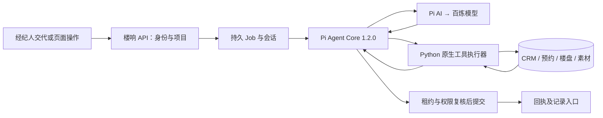

# 楼管家：豪宅经纪秘书与 Pi Agent 执行架构

更新日期：2026-10-15。

楼管家的目标是把经纪人的交代直接变成项目记录：安排会面与带看，维护客户背景、预算与偏好，更新楼盘资料，整理素材，并返回可打开的操作回执。聊天和页面编辑共用楼响业务数据，客户信息不以聊天历史作为唯一存储。

本次实际接入 `@earendil-works/pi-agent-core@1.2.0` 和 `@earendil-works/pi-ai@1.2.0`。依赖固定在 `apps/agent-runtime/package.json` 与锁文件，要求 Node.js 22.19.0 及以上。生产 Worker 的聊天入口使用 Pi 侧车及 Python 业务网关。本文说明实现与运行边界；前一轮五项秘书能力验收记录在 `reports/secretary-agent-20261015.json`，本轮单指令 CRM → 匹配 → 视频制作 → 自动续接 → 素材归档的真实成片证据记录在 `reports/secretary-video-chain-20261015.json`，测试与生产发布证据分别看待。

## 1. 执行架构

Pi Agent Core 负责模型请求、工具循环、任务纠正、后续队列、取消和生命周期事件；Python 负责身份、项目权限、业务校验、数据库事务和真实操作。模型供应商继续走楼响已有的百炼配置，使用 Pi AI 的 OpenAI-compatible Chat Completions 适配器。

侧车只接收当前任务所需的脱敏上下文、工具定义和执行结果。工具请求回到 Python，沿用服务端当前用户、租户与项目；模型参数不提供切换租户或绕过权限的入口。

应用默认不设置每日 token 用量上限。`DAILY_TOKEN_BUDGET`（非开发环境云模型）、`DEVELOPMENT_TOKEN_BUDGET`（开发环境云模型）与 `NATIVE_LOCAL_TEXT_DAILY_TOKEN_BUDGET`（本地/驻留 PPU 文字模型）默认均为 `0`，明确表示无限额度，不用极大数模拟无限。显式配置正值时仍按团队、UTC 日与云/本地用量分别检查；聊天、内容生成、原生技能和公开检索共用 `model_budget.py` 的策略。所有实际模型回执仍由独立计量记录保存，失败、取消或业务事务回滚不会抹去已产生的用量。供应商自身的可用额度和请求错误仍如实返回。

### 1.1 Pi 核心能力对应关系

| Pi Agent Core 接口 | 楼管家用途 | 接入边界 |
|---|---|---|
| `prompt()` | 处理经纪人本次交代 | 用户消息与 Job 先持久保存 |
| `continue()` | 根据已有消息或工具结果继续 | 必须恢复相应任务上下文，避免当成新任务重复写入 |
| `steer()` | 当前任务的纠正，例如“改到周四” | 在当前助手轮及其工具执行后进入；不自动撤销已执行操作 |
| `followUp()` | 当前任务完成后再处理补充交代 | 与当前任务纠正分开排队 |
| `abort()`、`waitForIdle()` | 停止与等待执行结束 | 数据能否提交仍由 Python worker 的租约及状态决定 |
| 队列模式与清理接口 | 单条或整批消化输入、清除待处理交代 | 对应 `one-at-a-time` / `all`、清除 steering / follow-up / 全部队列 |
| `beforeToolCall`、`afterToolCall` | 执行前检查、统一结果与错误事件 | 最终授权和参数校验仍在 Python 执行器 |
| `prepareRequest`、`transformContext` | 每次模型请求前注入当前上下文、控制历史体积 | 历史引用仍须重查权限与版本 |
| `finishTurn` | 判断继续查写、整理回执或结束 | 按实际任务与必需回执继续，不设置默认轮数、工具次数或累计 token 上限 |
| `subscribe()`、`state` | 进度、流式回复、工具状态、结算 | 以真实事件和持久任务状态驱动页面 |

工具执行使用串行模式。查客户、创建客户、写画像、建预约之间有依赖；同一数据库会话中的变更也不能由模型擅自并行提交。

工具按客户、楼盘/素材、制作、平台等当前任务领域按需装载，服务端保留完整注册表。人工插话真正被 Pi 消费后才切换工具与原始授权。写入任务先依据经纪人原话确定必需的业务回执组：例如同时改楼盘面积和素材描述，两组都必须实际成功。Pi 遇到仅查询就声称完成时继续调用缺失工具，Python 在最后再次核对；模型文本不能替代保存回执。

采用的是 Pi Core 实际 SDK。`pi-coding-agent` 的终端编码工具、文件系统与 Shell 能力、扩展生态、持久会话树和自动摘要压缩不属于本次 Core 接入范围；楼管家继续使用自己的数据库会话与业务工具。Core 提供上下文变换接口，不能据此宣称已经启用 coding-agent 的压缩或会话分支功能。[Pi Agent Core 官方说明](https://github.com/earendil-works/pi/blob/main/packages/agent/README.md)、[Pi SDK 分层说明](https://github.com/earendil-works/pi/blob/main/packages/coding-agent/docs/sdk.md)

## 2. 请求到回执的操作方案

1. **理解交代**：区分查阅和写入。经纪人直接说“记下”“改到”“预算两千万、喜欢江景”等可构成内部记录指令；只问“约在哪里”“上次记了什么”先读取。检索材料里的指令不能授予写权限。
2. **解析对象**：在当前项目与负责人的权限范围内找客户、素材或楼盘事实，使用查询返回的真实 ID。同名多条时让经纪人选择，不自动合并；客户不存在时可建立待完善档案。
3. **确定最小变更**：只写用户明确提供的字段，保留其余值。金额、财力、职业、偏好和家庭情况按实际交代记录，不由职业、姓名或房产价格推断。
4. **调用原生服务**：工具参数经服务端校验，逐项执行。预约时间、客户联系授权、素材受保护字段和事实版本各自遵循业务规则。
5. **核对结果**：工具返回保存后的记录、来源引用及仍缺的资料；需要核对关联记录时再调用读取工具，不能凭模型自己的执行计划宣称成功。
6. **事务提交与显示**：worker 复核权限及租约，提交业务变更、工具记录和回答。页面读取已完成回答后显示“已写入项目记录”，并可打开客户、素材或楼盘记录。

例如，以 2026-10-15 的北京时间为基准：

> 下周三下午约彭先生在售楼处看楼，把他的预算 2000 万、喜欢江景、希望安静记到 CRM。

处理顺序为 `search_customers` → 必要时 `create_customer` → `update_customer` → `schedule_viewing`。结果保存为 2026-10-21、下午、售楼处；没有具体时分，预约保持“待补充细节”。回执应清楚说明客户档案及会面已记录，并询问具体几点，不猜成 14:00。

后续说“他做跨境业务，预算改成 2500 万，太太一起决定，改到周四下午”，先重新读取这位客户和预约，再局部更新。改日时清除原来不再有效的具体时刻，保留未修改的地点与接待备注。若只问“下周三下午彭先生约在哪里见面”，读取既有预约回答。

## 3. 已存在的 CRM 与预约工具

实现位于 `apps/api/app/secretary.py`，数据模型位于 `secretary_models.py`。

| 工具 | 操作 |
|---|---|
| `search_customers` | 当前项目内按客户称呼检索；销售只看到有权负责的客户 |
| `create_customer` | 建立 `captured` 待完善客户及关联咨询，可同时记录需求与画像 |
| `update_customer` | 局部更新称呼、需求、下一步、画像和经明确授权的联系方式 |
| `record_followup` | 保存内部沟通与下一步，不向客户发送消息 |
| `schedule_viewing` | 建立会面或带看记录，允许细节待补充 |
| `update_viewing` | 修改日期、时间、地点、备注及状态 |
| `list_viewings` | 读取当前项目或指定客户的预约与缺失细节 |
| `match_customer_resources` | 按已保存的客户预算、面积要求与偏好，核对当前项目已核验事实，排序可用于制作的授权源素材 |

`get_customer`、`get_followups` 继续读取既有客户详情与跟进；详情包含画像及预约。跨对话通过业务记录读取，旧聊天引用只帮助确定查询对象。

`match_customer_resources` 实现在 `customer_matching.py`，是当前项目内的只读匹配工具。它从真实 CRM 档案解析带单位的预算、面积区间及已支持的偏好，返回楼盘匹配依据、冲突项、待确认项和真实素材 ID。总价、面积或偏好缺少有效事实时保留待确认；客户需求不会因此写成楼盘事实。素材排序依据名称、描述与标签中的偏好关键词，并保留授权、来源及模型处理许可状态；排序不包含图片或视频画面识别。匹配范围限当前选中楼盘，不能据此声称完成全市场房源推荐。

### 3.1 客户画像

`CustomerProfile` 与 `Lead` 一对一关联，包含 `details`、逐字段 `provenance`、更新时间，并继承租户和项目范围。

| 字段 | 含义 |
|---|---|
| `background` | 职业、业务领域与沟通背景 |
| `financial_situation` | 经纪人明确提供的财力情况及限制 |
| `budget` | 总价区间、付款方式、预算条件 |
| `preferences` | 景观、安静程度、朝向与生活偏好 |
| `family` | 家庭居住情况与共同决策人 |
| `requirements` | 面积、房间数、入住时间等要求 |
| `notes` | 接待、沟通及服务备注 |
| `source_note` | 本次信息的实际来源说明 |

每个修改字段记录来源、录入人、时间及 `self_reported` 可信度。记录客户自述不会自动变成已核实财力。建立档案与完成客户资格确认分开；待完善档案不会自动进入资格客户或重点客户统计。

### 3.2 联系方式的原生处理

已识别的电话、座机、国际号码、邮箱和带标记的微信号在聊天正文、模型输入、预览及工具记录中脱敏。任务所需原文以 `private_input_cipher` 加密保存，供 Python 原生秘书工具提取；原文不发送给 Pi 模型或侧车。

模型使用 `contact_from_message: true` 指示从本条原文提取，不生成或复述号码。一次提取只接受一个明确联系方式；多条时要求指定。保存联系信息要求用户明确说明客户同意后续联系，且 `consent_contact` 与原文证据一致。可以先记录其余画像与需求。

例如“把这条消息里的联系电话存到彭先生档案，客户已经同意后续联系”，由服务端提取、加密入咨询表，并保存租户内匹配指纹；客户资料界面仍默认隐藏，查看明文沿用已有受控入口和审计。任务完成、失败或取消后清理临时加密输入。联系方式和同名检索都不作为自动合并客户的依据。

### 3.3 预约字段与状态

`ViewingAppointment` 保存客户 ID、日期 `date`、大致时段 `time_window`、带时区的 `starts_at` / `ends_at`、`timezone`、地点、备注、状态、来源原话、创建人和更新时间。

- 业务时区固定 `Asia/Shanghai`；“今天”“明天”“下周三”按此时区的当前日期解析。
- `date_text` 保留相对日期原话交给服务端解释；“下午”保存为时段，不推测具体时间。
- 状态包括 `pending_details`、`scheduled`、`completed`、`cancelled`。日期、具体开始时间、地点齐全后才成为 `scheduled`。
- 返回 `missing_details` 与中文补充提示。具体日期与时刻冲突、结束早于开始时明确拒绝。
- 修改日期或时段、未提供新的具体时刻时，清除过时的开始及结束时间。
- 返回 `delivery: local_record_only`，表示楼响内部预约记录，不代表已通知客户或同步外部日历。

## 4. 已存在的楼盘与素材工具

实现位于 `apps/api/app/estate_tools.py`，沿用楼响原生项目、事实与素材模型。

| 工具 | 可修改范围与结果 |
|---|---|
| `get_property_details` | 读取项目基础资料、全部事实、待核验状态、版本及最近修订 |
| `update_property` | 项目名称、城市、类型、负责人、客群、销售承接人、渠道 |
| `create_property_fact` | 新增带实际来源的事实，初始待核验；同语义键已存在则提示读取修改 |
| `update_property_fact` | 修改事实值、单位、来源，增加版本与修订记录，恢复待核验 |
| `search_assets` | 按名称、描述、标签、自定义资料、类型检索素材目录 |
| `update_asset` | 修改素材名称、描述、标签及 `user_metadata` 内自定义资料 |

例如“把这个项目物业费改成 12 元/平方米/月，来源是今天拿到的物业说明”，先读取现有事实，携带版本修改，留下来源与修订；修改不自动完成事实核验。

例如“把大堂那张图改名为一层会客大堂，加上接待、会客标签，描述里记下适合给彭先生看”，先查素材，再更新目录字段。检索只返回目录信息，不因改描述而读取原文件正文。素材原文件、存储键、哈希、提取证据、授权和用途字段不属于可任意编辑的自定义资料。

事实和素材修改均支持 `expected_revision`。调用方应携带刚读取的版本；版本不符返回 409，重新读取后处理。该参数当前为可选，不能据此声称所有调用都有强制乐观锁。服务还使用行锁、修订号及审计保护相关变更。

## 5. 内容生产与运营操作的衔接

秘书能读取项目概况、资料缺口、发布指标、客户跟进、平台账号状态和已有运营任务。平台相关工具包括账号校验与登录启动、运营数据同步入队、住宅内容搜索入队、读取操作任务、准备发布包；返回任务 ID 表示已受理，不代表已取得数据或完成发布。

`production_tools.py` 把制作入口注册到同一 Pi 工具集，执行既有 Python 校验与持久任务：

| 工具 | 实际行为 |
|---|---|
| `get_production_capabilities` | 搜索原生技能，读取准确参数及当前就绪条件 |
| `plan_content` | 生成持久内容策划任务 |
| `generate_content` | 从已核验事实与选定计划生成脚本、分镜和版本 |
| `run_production_skill` | 调用原生文字、图像、音频、视频、文档与分析技能 |
| `render_content` | 将有效内容版本及授权素材送入视频渲染任务 |
| `get_production_job` / `list_production_jobs` | 读取真实状态、错误、版本及产物链接 |
| `list_project_content` | 找到可继续加工的内容版本与成片 |
| `cancel_production_job` | 取消有权限的制作任务 |
| `continue_after_production` | 持久保存下一步，上游真正结束后自动继续 |
| `archive_production_artifacts` | 将已成功原生制作任务的真实产物保存到当前项目素材库，可关联客户、标签和说明 |

例如“生成脚本，完成后继续配音，再渲染视频并归档”，每一步都消费真实上游结果。续接不设置固定层数，同一父任务与上游只有一个续接，措辞变化不能制造分支。上游失败或取消，网关阻止自动继续制作；经纪人可明确重新交代。生成的后续说明不能授予新权限，原始用户要求单独加密保存并校验。

自动续接从服务端工作流父链继承已经完成的操作回执，核对相同租户、项目、用户、对话及成功任务状态；客户匹配等只读依据还需重新检查引用权限与版本。已完成的 CRM 建档、画像写入或匹配可满足原始要求中对应步骤，避免归档时再次要求建档、匹配或发起制作。续接仍先用 `get_production_job` 检查本次上游真实结果，归档要求必须由对应制作任务的实际 `Asset` 回执满足。

后台等待不占住人工对话入口。即将结束时收到的补充指令若尚未被 Pi 消费，Worker 在完成事务内接成下一条持久任务，避免用户已经发送的交代丢失。

内容与媒体生产应区分排队、执行中、成功、失败及未配置依赖；成功应有实际产物入口。已登录账号、准备发布包、导出文件和平台发布回执保持各自含义。对外发布继续走已有审核与人工确认流程。

### 持续执行与停止

楼管家的实际 Pi 入口不设置任务总轮数、工具总次数、累计 token 或整轮五分钟截止。Python 传入 `maxTurns: null`、`maxToolCalls: null`，每日配额为无限时 `maxTotalTokens: null`；Node 将缺省、`null`、`0` 作为无限，而不是用很大的整数替代。单次模型输出使用模型声明的 `maxTokens`，不再额外截成 1200。模型自身上下文和响应规格仍按供应商协议处理。

制作续接可超过五层；父链回执沿真实祖先遍历，使用已见任务集合防止环，并逐项复核租户、项目、用户、私有对话、成功状态和来源版本，避免在后续步骤重复建档或写入。前端对聊天任务持续等待真实终态，不再默认十分钟停止；显式请求超时仍有效。取消、权限撤回、上游失败、工具参数和事务租约检查继续生效。Worker 续租及 SSE 连接轮换是运行机制，不是任务总时长上限。

Node 对 Python 的完成事件只传回文字、用量等结果摘要，不重复传整段运行历史；内存中的 Pi 引擎返回值仍保留可恢复状态，避免长任务撞到无用途的历史传输帧大小。

### 5.1 制作参数预检

调用原生技能前，先通过 `get_production_capabilities` 读取所选技能实际输入及参数契约。`media_plan_contract.py` 对 `auto-short-video`、`slideshow-video` 的参数在入队前预检，并由实际执行器再次校验。画面与背景音索引统一使用本次 `asset_ids` 完整原始顺序，从 0 开始；每镜 `asset_index` 指向图片或适用的视频，`bgm_index` 指向音频，不过滤、重排素材，也不用素材 UUID 或路径代替索引。

非空 `storyboard` 每镜必须指定画面索引，时长、起点和字幕按真实格式校验；`captions` 是字幕文字数组。没有分镜或表单默认空数组时，使用 `per` / `captions` 模式。参数不符会返回具体问题及带类型的可用素材索引，允许模型修正后重试。预检负责参数结构，素材授权、文件完整性、编码与实际视频时长仍由原生服务及执行器核验；预检通过只表示可以提交制作。

### 5.2 成片归档与可信视频入口

`production_archive.py` 中的 `archive_production_artifacts` 要求原始交代明确包含归档意图，且当前项目的 `content_skill` 任务已成功并带有 `housignal_native` 产物回执。`names` 只能选择该任务回执中的真实文件名；归档前检查产物哈希、大小、类型和媒体信息，并复查源素材授权及文件完整性。归档保留源任务、源素材与授权版本，可保存 `lead_id`、标签和描述；相同任务、文件名及哈希重复归档复用已有素材。

归档产物进入项目私有素材库，保留测试、合成或实际来源，并设置 `model_processing_authorized: false`、`review_required: true`、`publication_state: not_published`。来源于授权素材的剪辑继续受原授权用途约束，保存成片不会取得额外营销或发布授权。

聊天回执的视频入口从服务端核验的已归档 `Asset` 构建，使用当前项目的 `/api/projects/{pid}/assets/{asset_id}/file`；制作任务附件入口同样受任务身份和真实产物回执约束。归档回答中的视频链接由服务端实际记录校正，页面通过可信回执提供播放与下载。文件请求继续校验登录和项目访问权限，不能仅凭模型生成的域名或链接判断视频已经可用。

## 6. 事务、去重与操作回执

业务工具只 `flush`，不自行 `commit`。聊天调用由 worker 持有外层事务，工具逐个使用 savepoint；某工具被拒绝不会留下该次操作的半份客户、资料或预约。若整个聊天任务失败，外层事务回滚；若某工具错误后任务继续完成，最终回执应如实区分成功与失败操作。

同一聊天任务内，以工具名称与标准化参数缓存成功写入结果；模型重复提出同一个调用时复用结果，不重复创建记录或显示第二张写入回执。这是本任务内去重，不等于跨任务、跨用户消息的全局 exactly-once。经纪人再次交代新增预约时，仍应查询已有预约，区分补充、修改与真正新建。

worker 提交采用 Job 状态、`lease_token`、`attempt`、租约有效期的条件更新；业务写入与成功状态同时提交。取消、租约替换或过期导致旧 worker 写回不被采纳。供应商已收到的模型请求不一定能够撤回，不能把取消解释为外部成本未发生。

每次工具调用保存脱敏参数、任务与对话关联、完整权限来源；实际写入保存 `_receipt`。仅已完成助手消息、确实应用的写入和可见来源生成 `actions`，包含操作名、摘要、修改字段与记录入口。进度阶段不提前展示尚未提交的业务写入，最终页面从已保存消息读取回执。

已有来源在模型请求前、任务结束及消息读取时复核权限和版本。楼管家自己修改的事实可以用本次新版本承接旧引用；他人后续修改仍使原引用过时。历史缩短不能移除权限检查所依赖的完整来源。

## 7. 页面与聊天的数据一致性

- “咨询与客户”的客户详情展示画像、联系方式入口、跟进、会面带看；画像和预约可直接编辑。
- 页面画像 PATCH 与聊天 `update_customer` 复用 `update_customer_data`；页面预约 POST/PATCH 与聊天共用 `schedule_viewing_data` / `update_viewing_data`。
- 跟进、客户资格和销售阶段继续读写已有 CRM 服务与记录；秘书保存内部信息不替代人工资格确认。
- 楼盘和素材工具操作原生 `Property` / `Fact` / `Asset`，页面和聊天读到同一份记录；未统一的入口应继续收敛到相同业务服务，避免另建一套聊天数据库。
- 聊天成功后存在实际操作回执时刷新项目数据；回执入口打开相应客户、楼盘事实或素材。客户详情提供“让楼管家跟进”，将当前对象上下文带入输入草稿，由用户继续交代。
- 草稿及历史消息不等于已经执行。发送后要查看任务结果和操作回执；页面刷新失败时保留“已保存、刷新失败”的准确提示。

## 8. 当前边界与后续工作

本次实施的是实际 Pi Core 执行引擎与楼响原生秘书业务。SDK 导入、侧车协议、控制输入、事件映射和 Python 集成须以本仓库测试及真实运行结果验收；依赖安装成功本身不代表端到端完成。

前一轮本地真实模型验收完成五项：建档与暂定看楼、画像/改期/跟进、加密联系方式、楼盘事实及素材联合修改、生产能力查询；均检查了持久记录。该轮使用显式合成项目，未生成付费媒体、未对外发布。回执见 [五项秘书能力验收](../reports/secretary-agent-20261015.json)，整体验证索引见 `reports/secretary-integration-verification-20261015.json`。

本轮另以一条完整交代执行真实 Pi / 百炼模型端到端验收，结果 **9/9 通过**，证据见 [单指令视频链路验收](../reports/secretary-video-chain-20261015.json)。在显式合成测试项目中，系统自动完成 CRM 建档与需求保存 → 当前项目事实和授权图片匹配 → 本地视频制作 → 上游成功后自动续接 → 成片入素材库并关联客户、标签。三张授权合成住宅图片与一条 20 秒本地原创 WAV 用于剪辑，另设一张无关高楼层办公室图片验证排除结果。

| 本轮检查 | 实际证据 |
|---|---|
| 合成素材准备 | 3 张匹配授权图片、1 张无关对照图片、20 秒原创音轨 |
| 客户持久记录 | 单一客户档案保存预算、面积和偏好，无重复建档 |
| 实际资源匹配 | 调用 `match_customer_resources`，选出三张住宅图片并排除无关办公室 |
| 原生视频任务 | 实际 `native:auto-short-video` 任务成功，消费指定图片和音轨 |
| 自动续接与归档 | 后续聊天任务自动成功，成片归档为 `Asset` 并关联客户与标签 |
| 文件与受控下载 | MP4 哈希、大小与归档一致，登录下载成功，匿名访问返回 401 |
| 视频解码与音轨 | 20 秒、720×1280、H.264 / AAC，完整解码成功且音轨有实际信号 |
| 中文字幕 | 三镜 6 / 7 / 7 秒的字幕时间清单，包含合成示意及非真实房源标识 |
| 采样画面复核 | 留存 6 个采样帧及拼图，记录三组不同画面、清晰中文字幕和无关素材排除结果 |

可复核的本地成片为 [final.mp4](../reports/secretary-video-chain-20261015/final.mp4)，采样拼图为 [contact-sheet.png](../reports/secretary-video-chain-20261015/contact-sheet.png)。本轮调用了真实文字模型完成调度，媒体使用既有图片与原创 WAV 本地剪辑，**未调用付费媒体生成、未对外发布、未联系客户**。五项秘书能力验收与本轮真实成片证据各自保留；上述结果不包含真实客户、真实房源商业交付或平台发布验收。

以下能力需要单独实现与验收：到点唤醒的持久定时器、自动提醒投递、外部日历双向同步、短信或微信联系客户、通话与录音接入、业务撤销或补偿操作。Pi 的 steering / follow-up 队列负责当前 Agent 执行调度，不是预约时间触发器。

Pi coding-agent 的会话树、压缩、MCP、Codemode 及全部第三方扩展没有因导入 Core 而自动启用。需要时逐项接入并声明工具权限，保持本项目、当前用户和已有审批边界。

## 9. 参考来源

- [Pi Agent Core 官方 README](https://github.com/earendil-works/pi/blob/main/packages/agent/README.md)：Agent、工具循环、事件、队列及控制接口。
- [Pi AI 官方 README](https://github.com/earendil-works/pi/blob/main/packages/ai/README.md)：自定义模型、OpenAI-compatible 协议、流式适配。
- [Pi coding-agent SDK](https://github.com/earendil-works/pi/blob/main/packages/coding-agent/docs/sdk.md)：Core 与持久会话、资源及扩展层的区别。
- [Easel 执行底座接入](https://github.com/ZJU-REAL/Easel/blob/main/docs/agent-harnesses.md)：模型与引擎分离、适配器事件、取消与会话绑定。
- [Easel Prompt Stack](https://github.com/ZJU-REAL/Easel/blob/main/docs/prompt-stack.md)：人格、编排、运行时权限、按需技能及画像隔离。

Easel 的引擎适配与分层上下文用于研究业务编排方式；楼响的 CRM、预约、楼盘、素材和内容服务仍在本仓库原生实现。没有引入 Easel 项目作为运行依赖。
